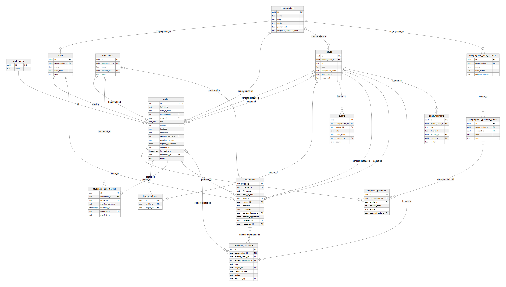
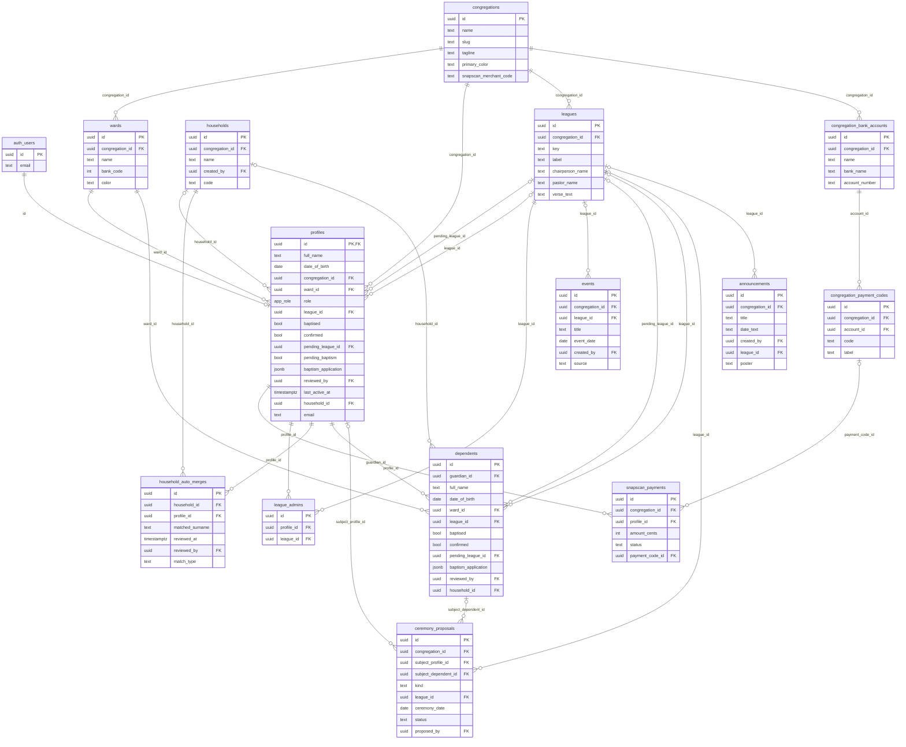

# Database diagram (ERD)

How the app's data is organised: 14 tables, the links between them, and what each one is for.
This page is generated from the real database schema (all 31 migrations applied), so it matches production.

## The diagram

*Crow's-foot notation: a line with a fork at one end means "many"; a double bar means "exactly one"; a bar with a circle means "zero or one". Only keys and the most important columns are drawn. To keep it readable the picture leaves out two kinds of link: every table's link to its congregation (all tables belong to one), and "who created / reviewed this" links to `profiles`. Both are listed in full in the relationship table at the bottom.*

Diagram source (Mermaid) — GitHub also draws this directly

## Reading it in plain words

- A **congregation** owns everything: its **wards**, **leagues**, **members**, **announcements**, **events** and **bank details**. Nothing is shared between congregations.
- A **profile** is a person who signs in. It is the same record as the sign-in account (`auth.users`), and belongs to one congregation, one ward, and optionally one league and one household.
- A **household** is a family. It has many profiles and many **dependents** (children without a phone). A child's `guardian_id` points to the adult who manages them.
- A **league admin** row links one member to one league.
- A **ceremony proposal** links an admin's suggested date to the adult or child it is for.
- **Announcements** and **events** either belong to the whole congregation or, if `league_id` is set, to one league.
- A **bank account** has many **payment codes**; a **SnapScan payment** records one giving transaction by one member.

## Security rules that apply to every table

Row Level Security is switched on for **all 14 tables**. In short:

- You can only read rows from **your own congregation**.
- A member can read and change **their own** profile and their children; they cannot give themselves admin, mark themselves baptised, or edit anyone else.
- Writes that matter (approving requests, changing roles, editing other people, settings) are done through database **functions** that check the caller is an admin *inside the database*.
- `snapscan_payments` can only be updated by the SnapScan webhook.

See [ARCHITECTURE.md](ARCHITECTURE.md) for the full model, and `supabase/tests/rls.test.mjs` for the tests that enforce it.

Enumerated types: `app_role` = member, admin; `gender` = Male, Female.

## Table by table

### `announcements`

A post for the whole church (`league_id` empty) or one league. May carry a poster image.

| Column | Type | Required | Links to / notes |
|---|---|---|---|
| `id` | uuid | default | Primary key. |
| `congregation_id` | uuid | yes | → `congregations.id` (deleted with it) |
| `title` | text | yes |  |
| `date_text` | text | default | Free text such as "Sunday 31 October, 09:00" — not a real date. |
| `body` | text | default |  |
| `created_at` | timestamptz | default |  |
| `created_by` | uuid | default | → `profiles.id` (blocks its deletion) |
| `league_id` | uuid | optional | → `leagues.id` (blocks its deletion) |
| `poster` | text | optional | Optional image stored as a data URI. |

### `ceremony_proposals`

A date an admin proposes for a baptism, confirmation or league installation. The member (or a child's parent) accepts it before the request completes.

| Column | Type | Required | Links to / notes |
|---|---|---|---|
| `id` | uuid | default | Primary key. |
| `congregation_id` | uuid | yes | → `congregations.id` (deleted with it) |
| `subject_profile_id` | uuid | optional | → `profiles.id` (deleted with it) The adult it is for… |
| `subject_dependent_id` | uuid | optional | → `dependents.id` (deleted with it) …or the child. Exactly one of the two is set. |
| `kind` | text | yes | baptism, confirmation or league. |
| `league_id` | uuid | optional | → `leagues.id` (blocks its deletion) |
| `ceremony_date` | date | yes |  |
| `status` | text | default | pending, confirmed or declined. |
| `proposed_by` | uuid | optional | → `profiles.id` (blocks its deletion) |
| `responded_at` | timestamptz | optional |  |
| `created_at` | timestamptz | default |  |

### `congregation_bank_accounts`

A bank account shown on the Banking tab.

| Column | Type | Required | Links to / notes |
|---|---|---|---|
| `id` | uuid | default | Primary key. |
| `congregation_id` | uuid | yes | → `congregations.id` (deleted with it) |
| `name` | text | yes |  |
| `bank_name` | text | yes |  |
| `account_number` | text | yes |  |
| `branch_code` | text | yes |  |
| `sort_order` | int | default |  |

### `congregation_payment_codes`

A reference code (for example PLG – Pledge & Tithe) members put on a deposit, tied to one bank account.

| Column | Type | Required | Links to / notes |
|---|---|---|---|
| `id` | uuid | default | Primary key. |
| `congregation_id` | uuid | yes | → `congregations.id` (deleted with it) |
| `account_id` | uuid | yes | → `congregation_bank_accounts.id` (deleted with it) |
| `code` | text | yes |  |
| `label` | text | yes |  |
| `sort_order` | int | default |  |

### `congregations`

A parish using the app. Everything else belongs to exactly one congregation, which is how one parish can never see another's data.

| Column | Type | Required | Links to / notes |
|---|---|---|---|
| `id` | uuid | default | Primary key. |
| `name` | text | yes |  |
| `slug` | text | yes | URL-safe name used when choosing a congregation to register with. |
| `address` | text | optional |  |
| `domain` | text | optional |  |
| `tagline` | text | optional |  |
| `created_at` | timestamptz | default |  |
| `logo_url` | text | optional | The parish logo, stored as a small data URI. |
| `primary_color` | text | default | Brand colour (hex). |
| `accent_color` | text | optional |  |
| `snapscan_qr_url` | text | optional | Unused now — the QR-code option was removed. |
| `snapscan_merchant_code` | text | optional | Turns on the *Pay with SnapScan* button when set. |

### `dependents`

A child registered under a parent or guardian (`guardian_id`). Has its own ward, league and sacrament fields, like a profile, but no login.

| Column | Type | Required | Links to / notes |
|---|---|---|---|
| `id` | uuid | default | Primary key. |
| `guardian_id` | uuid | yes | → `profiles.id` (deleted with it) The adult profile who manages this child. Deleting the guardian deletes the child. |
| `full_name` | text | yes |  |
| `date_of_birth` | date | optional |  |
| `gender` | gender | optional |  |
| `ward_id` | uuid | yes | → `wards.id` (blocks its deletion) |
| `league_id` | uuid | optional | → `leagues.id` (blocks its deletion) |
| `baptised` | bool | default |  |
| `confirmed` | bool | default |  |
| `pending_league_id` | uuid | optional | → `leagues.id` (blocks its deletion) |
| `pending_baptism` | bool | default |  |
| `pending_confirmation` | bool | default |  |
| `baptism_application` | jsonb | optional |  |
| `confirmation_application` | jsonb | optional |  |
| `league_application` | jsonb | optional |  |
| `reviewed_by` | uuid | optional | → `profiles.id` (blocks its deletion) |
| `reviewed_at` | timestamptz | optional |  |
| `created_at` | timestamptz | default |  |
| `household_id` | uuid | optional | → `households.id` (cleared if it is removed) The family the child is shown in. |

### `events`

A dated calendar entry, church-wide or for one league.

| Column | Type | Required | Links to / notes |
|---|---|---|---|
| `id` | uuid | default | Primary key. |
| `congregation_id` | uuid | yes | → `congregations.id` (deleted with it) |
| `league_id` | uuid | optional | → `leagues.id` (blocks its deletion) |
| `title` | text | yes |  |
| `event_date` | date | yes |  |
| `end_date` | date | optional |  |
| `description` | text | optional |  |
| `created_at` | timestamptz | default |  |
| `created_by` | uuid | default | → `profiles.id` (blocks its deletion) |
| `source` | text | default | `manual` when posted by hand, or set when created automatically from a confirmed ceremony. |

### `household_auto_merges`

A match the app made automatically at registration (same ward and surname as an existing family). Waits for an admin to **Confirm** or **Split Off**.

| Column | Type | Required | Links to / notes |
|---|---|---|---|
| `id` | uuid | default | Primary key. |
| `household_id` | uuid | yes | → `households.id` (deleted with it) |
| `profile_id` | uuid | yes | → `profiles.id` (deleted with it) |
| `matched_surname` | text | yes |  |
| `created_at` | timestamptz | default |  |
| `reviewed_at` | timestamptz | optional | Set once an admin has dealt with it. |
| `reviewed_by` | uuid | optional | → `profiles.id` (blocks its deletion) |
| `match_type` | text | default | How it was matched. |

### `households`

A family. Has a short shareable `code`; whoever first uses a fresh code names the family after themselves.

| Column | Type | Required | Links to / notes |
|---|---|---|---|
| `id` | uuid | default | Primary key. |
| `congregation_id` | uuid | yes | → `congregations.id` (deleted with it) |
| `name` | text | optional | Empty until the code is claimed. |
| `created_by` | uuid | optional | → `profiles.id` (blocks its deletion) |
| `created_at` | timestamptz | default |  |
| `code` | text | yes | Short code a relative can enter to join this family. |

### `league_admins`

Gives a member admin rights for one league only. A person can administer several leagues.

| Column | Type | Required | Links to / notes |
|---|---|---|---|
| `id` | uuid | default | Primary key. |
| `profile_id` | uuid | yes | → `profiles.id` (deleted with it) |
| `league_id` | uuid | yes | → `leagues.id` (deleted with it) |
| `created_at` | timestamptz | default |  |

### `leagues`

A league or organisation members can belong to (Prayer Youth League, Young Adults League, …).

| Column | Type | Required | Links to / notes |
|---|---|---|---|
| `id` | uuid | default | Primary key. |
| `congregation_id` | uuid | yes | → `congregations.id` (deleted with it) |
| `key` | text | yes | Stable name used to pick the right badge artwork; not the same as the row id. |
| `label` | text | yes |  |
| `info` | text | optional |  |
| `color` | text | default |  |
| `has_badge` | bool | default | Whether bundled badge artwork exists for this league. |
| `chairperson_name` | text | optional | Printed on installation certificates. |
| `pastor_name` | text | optional | Printed on installation certificates. |
| `verse_reference` | text | optional | Certificate verse, e.g. Romans 12:2. Empty → a default verse is printed. |
| `verse_text` | text | optional | The verse text for certificates. |

### `profiles`

One row per person who signs in. **`id` is the same value as the sign-in account's id** (`auth.users.id`), so the profile and the login are one-to-one.

| Column | Type | Required | Links to / notes |
|---|---|---|---|
| `id` | uuid | yes | → `auth.users.id` (deleted with it) |
| `full_name` | text | yes |  |
| `phone` | text | optional |  |
| `date_of_birth` | date | optional |  |
| `gender` | gender | optional |  |
| `congregation_id` | uuid | yes | → `congregations.id` (blocks its deletion) |
| `ward_id` | uuid | yes | → `wards.id` (blocks its deletion) The ward they belong to. |
| `role` | app_role | default | `member` or `admin`. Only changed through admin functions. |
| `league_id` | uuid | optional | → `leagues.id` (blocks its deletion) The league they belong to now. |
| `baptised` | bool | default |  |
| `confirmed` | bool | default |  |
| `pending_league_id` | uuid | optional | → `leagues.id` (blocks its deletion) A league they have asked to join, waiting for review. |
| `pending_baptism` | bool | default | They have asked to be baptised. |
| `pending_confirmation` | bool | default | They have asked to be confirmed. |
| `baptism_application` | jsonb | optional | JSON: type, sponsor, place, officiant — and, from the office, register number, diocese, parents, birth place, verse. Kept after approval so certificates can use it. |
| `confirmation_application` | jsonb | optional | JSON: mentor, place, officiant. |
| `league_application` | jsonb | optional | JSON: reason for joining. |
| `reviewed_by` | uuid | optional | → `profiles.id` (blocks its deletion) The admin who last approved or denied a request. |
| `reviewed_at` | timestamptz | optional |  |
| `created_at` | timestamptz | default |  |
| `last_active_at` | timestamptz | optional | Last time they opened the app. |
| `membership_confirmed_at` | timestamptz | optional | When they last answered "Yes, still here". |
| `self_reported_left_at` | timestamptz | optional | When they answered "I've left". |
| `household_id` | uuid | optional | → `households.id` (cleared if it is removed) The family they are in. |
| `profession` | text | optional | Optional; sharing one puts the member in the directory. |
| `email` | text | optional |  |
| `is_service_account` | bool | default | A generic league login; left out of headcounts. |

### `snapscan_payments`

A payment started inside the app through SnapScan. Created by the app, **updated only by the SnapScan webhook**; members can never edit it.

| Column | Type | Required | Links to / notes |
|---|---|---|---|
| `id` | uuid | default | Primary key. |
| `congregation_id` | uuid | yes | → `congregations.id` (deleted with it) |
| `profile_id` | uuid | yes | → `profiles.id` (deleted with it) |
| `merchant_reference` | text | yes |  |
| `amount_cents` | int | yes |  |
| `status` | text | default | pending until SnapScan confirms. |
| `snapscan_payment_id` | text | optional |  |
| `raw_webhook` | jsonb | optional |  |
| `created_at` | timestamptz | default |  |
| `completed_at` | timestamptz | optional |  |
| `payment_code_id` | uuid | optional | → `congregation_payment_codes.id` (blocks its deletion) |

### `wards`

A geographic/administrative group inside a congregation (Central, East, North, South, West).

| Column | Type | Required | Links to / notes |
|---|---|---|---|
| `id` | uuid | default | Primary key. |
| `congregation_id` | uuid | yes | → `congregations.id` (deleted with it) |
| `name` | text | yes |  |
| `bank_code` | int | yes | Number used in payment references so a deposit can be traced to a ward. |
| `color` | text | default |  |

## Relationships (every foreign key)

| From | To | If the parent is deleted |
|---|---|---|
| `announcements.congregation_id` | `congregations.id` | rows are deleted too |
| `announcements.created_by` | `profiles.id` | deletion is blocked |
| `announcements.league_id` | `leagues.id` | deletion is blocked |
| `ceremony_proposals.congregation_id` | `congregations.id` | rows are deleted too |
| `ceremony_proposals.league_id` | `leagues.id` | deletion is blocked |
| `ceremony_proposals.proposed_by` | `profiles.id` | deletion is blocked |
| `ceremony_proposals.subject_dependent_id` | `dependents.id` | rows are deleted too |
| `ceremony_proposals.subject_profile_id` | `profiles.id` | rows are deleted too |
| `congregation_bank_accounts.congregation_id` | `congregations.id` | rows are deleted too |
| `congregation_payment_codes.account_id` | `congregation_bank_accounts.id` | rows are deleted too |
| `congregation_payment_codes.congregation_id` | `congregations.id` | rows are deleted too |
| `dependents.guardian_id` | `profiles.id` | rows are deleted too |
| `dependents.household_id` | `households.id` | link is cleared |
| `dependents.league_id` | `leagues.id` | deletion is blocked |
| `dependents.pending_league_id` | `leagues.id` | deletion is blocked |
| `dependents.reviewed_by` | `profiles.id` | deletion is blocked |
| `dependents.ward_id` | `wards.id` | deletion is blocked |
| `events.congregation_id` | `congregations.id` | rows are deleted too |
| `events.created_by` | `profiles.id` | deletion is blocked |
| `events.league_id` | `leagues.id` | deletion is blocked |
| `household_auto_merges.household_id` | `households.id` | rows are deleted too |
| `household_auto_merges.profile_id` | `profiles.id` | rows are deleted too |
| `household_auto_merges.reviewed_by` | `profiles.id` | deletion is blocked |
| `households.congregation_id` | `congregations.id` | rows are deleted too |
| `households.created_by` | `profiles.id` | deletion is blocked |
| `league_admins.league_id` | `leagues.id` | rows are deleted too |
| `league_admins.profile_id` | `profiles.id` | rows are deleted too |
| `leagues.congregation_id` | `congregations.id` | rows are deleted too |
| `profiles.congregation_id` | `congregations.id` | deletion is blocked |
| `profiles.household_id` | `households.id` | link is cleared |
| `profiles.id` | `auth.users.id` | rows are deleted too |
| `profiles.league_id` | `leagues.id` | deletion is blocked |
| `profiles.pending_league_id` | `leagues.id` | deletion is blocked |
| `profiles.reviewed_by` | `profiles.id` | deletion is blocked |
| `profiles.ward_id` | `wards.id` | deletion is blocked |
| `snapscan_payments.congregation_id` | `congregations.id` | rows are deleted too |
| `snapscan_payments.payment_code_id` | `congregation_payment_codes.id` | deletion is blocked |
| `snapscan_payments.profile_id` | `profiles.id` | rows are deleted too |
| `wards.congregation_id` | `congregations.id` | rows are deleted too |

---

*This page reflects migrations 0001–0031. If you add a migration that changes a table, update the diagram and the table sections to match.*
