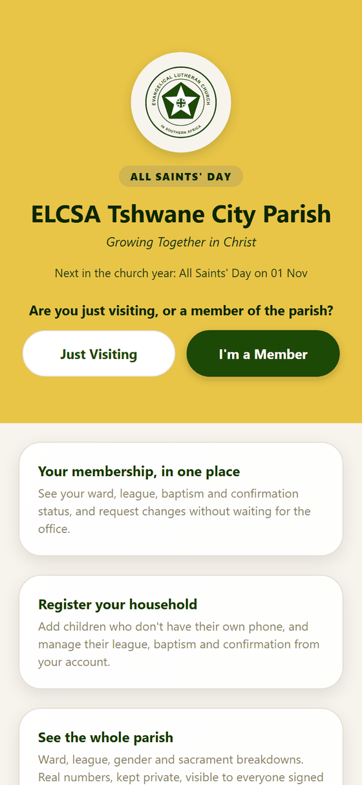
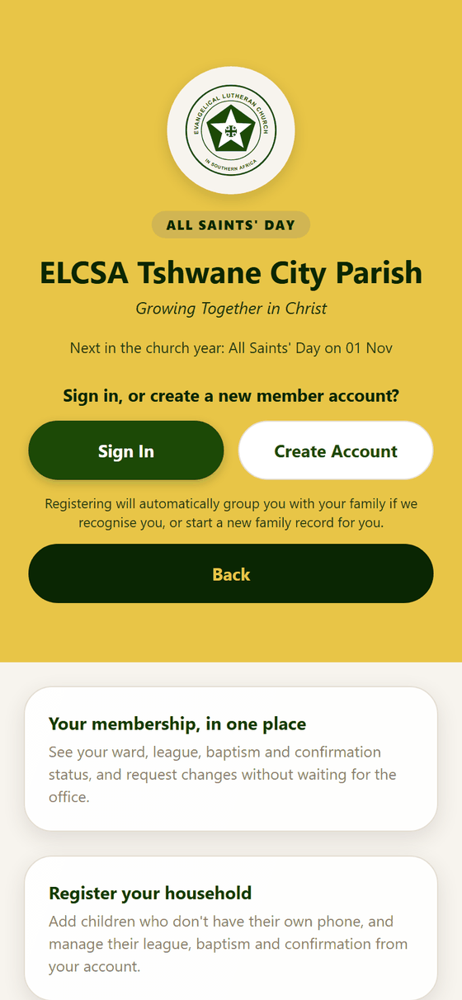
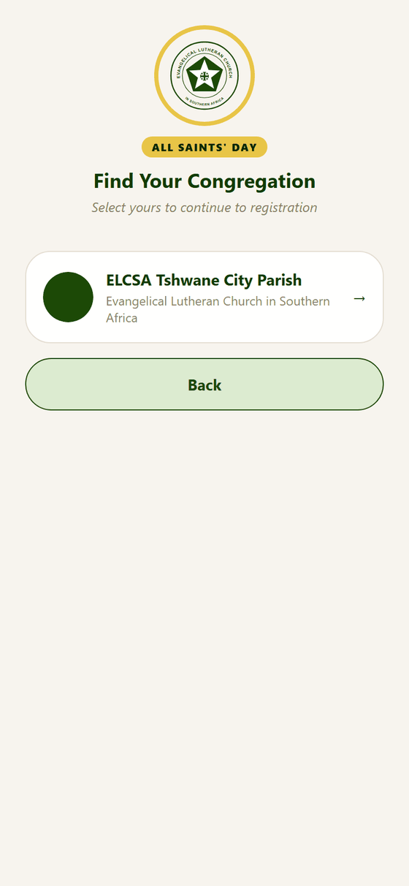
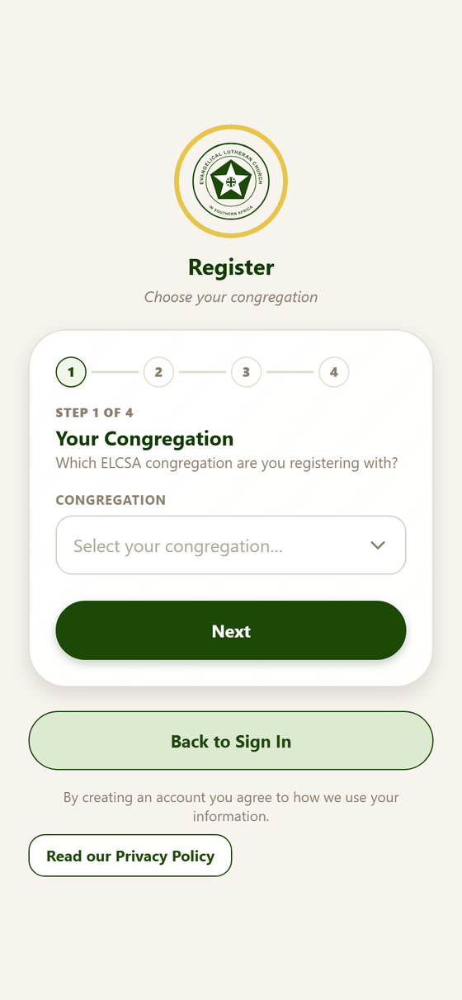
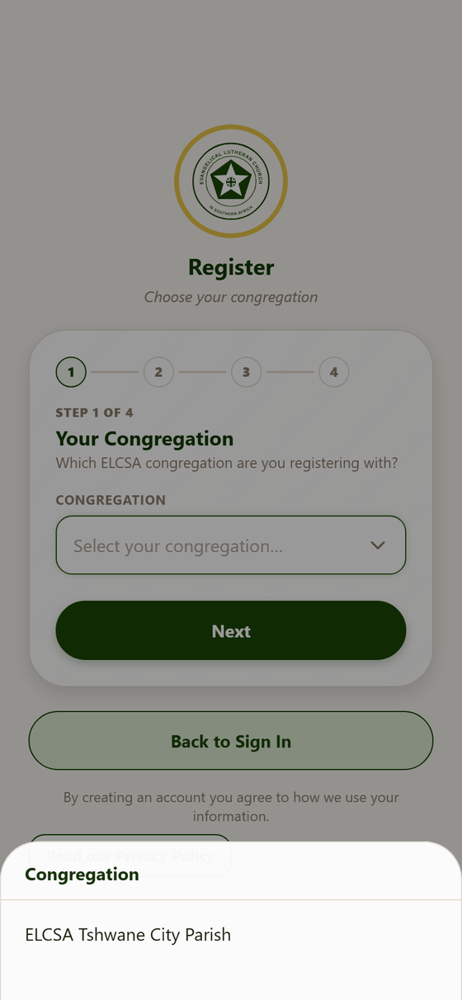
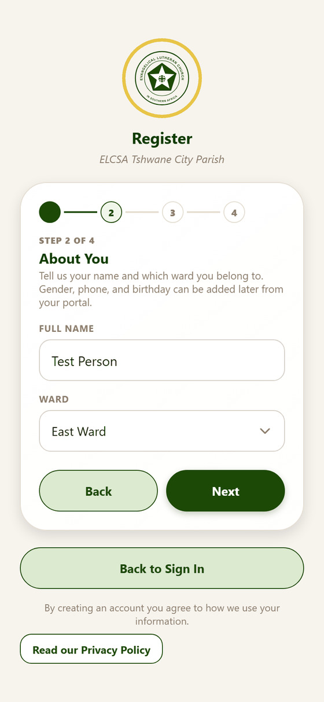
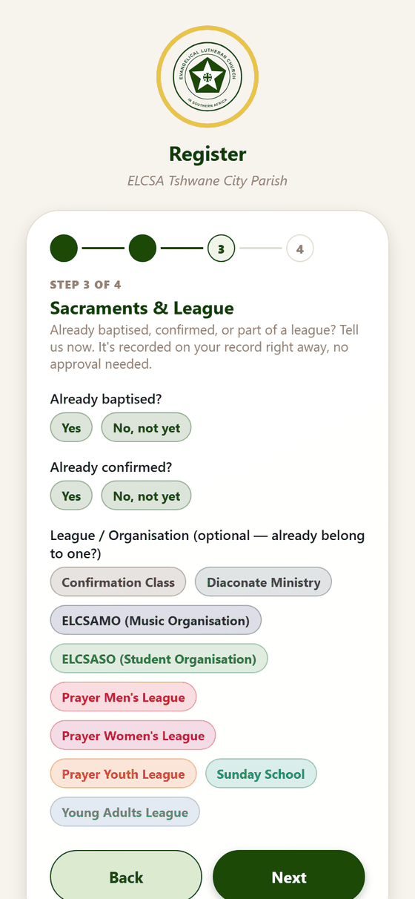
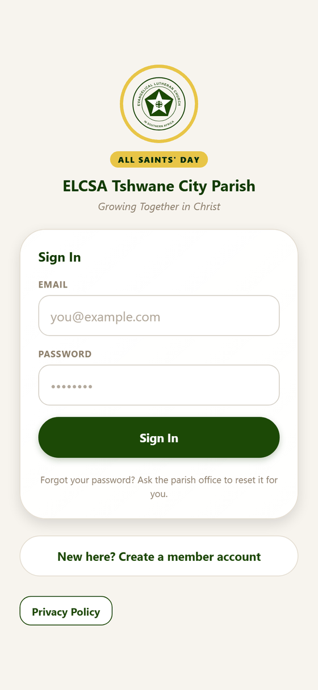
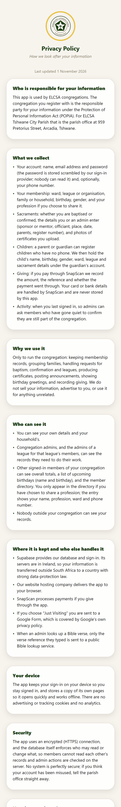

# 1. Visitors, registering and signing in

**For:** anyone opening the app for the first time — visitors, new members and members signing in.

Everything here happens *before* you are signed in. When you do sign in, carry on with
[Your portal](02-your-portal.md).

## The front page

*The front page. The banner colour follows the church year — here it is gold for All Saints' Day; it is green most of
the year, purple in Lent and Advent, red at Pentecost.*

The front page shows the parish crest, the season of the church year and what comes next on the church calendar
("Next in the church year: All Saints' Day on 01 Nov"). It asks one question: **are you visiting, or a member?**

| Button | What it does |
|---|---|
| **Just Visiting** | Opens the parish's visitor form (a Google Form) so the office can follow up with you. |
| **I'm a Member** | Shows the member choices below. |
| **Install the app** | Appears where your browser can install the app. See [Phone, desktop and installing](10-phone-desktop-and-install.md). |
| **Find Your Congregation** (further down) | For members of a different ELCSA congregation that uses this app. |
| **Privacy Policy** | The full policy, in the app. |

Below the buttons are short cards explaining what the app does: your membership in one place, registering your household,
and seeing the whole parish's numbers.

*After tapping **I'm a Member**: sign in if you already have an account, or create one.*

### Finding your congregation

The app serves more than one congregation, and each keeps its own members, wards and leagues. **Find Your Congregation**
lists them; tap yours to start registering with it already chosen.

## Creating your account

Tap **Create Account**. Registration is four short steps. A progress line at the top shows where you are, and **Back** and **Next**
move between steps. Nothing is saved until the end, and you can go back and change an answer.

### Step 1 — Your congregation

Choose the congregation you belong to. Tapping the box opens a list:

### Step 2 — About you

Your **full name** and your **ward**. Your phone number, birthday and gender are optional and can be added later from
[Your portal](02-your-portal.md#my-details). (Wards are the parish's geographic groups — East, West, Central and so on.)

### Step 3 — Sacraments and league

Tell the parish what is already true: **Already baptised?**, **Already confirmed?** and, if you already belong to one, your
**league or organisation**. Say yes to baptism and a few optional questions appear (the baptism type, your sponsor or godparent, where it was and who baptised you); say yes to confirmation and you can add your mentor, the place and who confirmed you.
Confirmation always follows baptism, so the app won't accept "confirmed" without "baptised".

This is recorded straight away, with no approval needed, because it is something that has already happened. If you would like to be baptised or
confirmed *in the future*, that is a request you make later from your portal — see
[Update your involvement](02-your-portal.md#update-your-involvement).

### Step 4 — Your login

Your **email** and a **password of at least 8 characters**, typed twice. This is what you use to sign in from now on.
The app does not send email, so you do **not** need to confirm your address — you are signed in as soon as you finish.

Under the form you will see a line saying that creating an account means you agree to how your information is used, with a button to read the
Privacy Policy.

> **What happens with your family?** If someone with your surname in the same ward has already registered, the app places you in their
> family automatically and asks the office to double-check. See [Family and household](03-family-and-household.md).

## Signing in

Enter your email and password and press **Sign In**. Under the button is a reminder:
**"Forgot your password? Ask the parish office to reset it for you."** The app sends no emails, so there is no reset link —
the office sets a temporary password for you.

The sign-in screen also has **New here? Create a member account**, **Install the app** (where available) and **Privacy Policy**.

Signing in takes members to **My Portal** and the office team to the **Dashboard**.

## The privacy policy

A plain-language page, open to everyone, covering what is collected, who can see it, where it is stored, how long it is kept and your rights.
It is linked from the front page, the sign-in screen and registration.
