# 2. Your portal (members)

**For:** members who have signed in. **My Portal** is your home screen: your status in the parish, your details, and the requests you can make.

If you are a member of the office team, see the admin guides starting at [Dashboard & registry](06-admin-dashboard-and-registry.md). Your own portal still works the same way for you as a member.

## The top of the portal

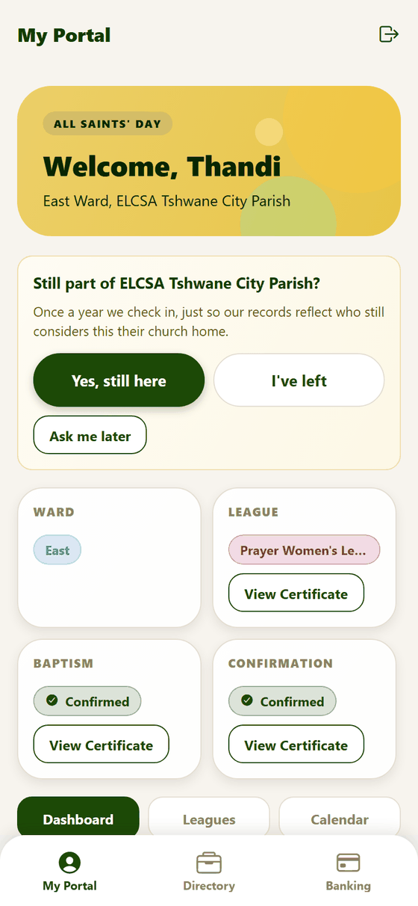

From the top:

1. **The welcome banner** — your name, your ward and the parish. Its colour follows the season of the church year.
2. **The yearly check-in** (only sometimes — see below).
3. **Four status cards:** your **Ward**, your **League**, your **Baptism** and your **Confirmation**. Once baptism, confirmation or a league is on record, each shows a
   **View Certificate** button — see [Certificates](04-certificates.md). A request still waiting for the office shows **Pending Review**; something not yet done shows **Not Yet**.
4. **Dashboard / Leagues / Calendar** buttons that switch what is shown below.

On a computer the same portal uses the extra width — four status cards in a row and two columns below:

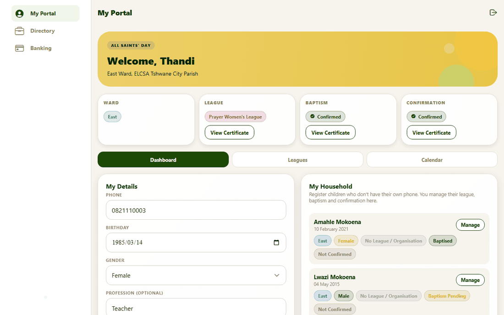

### The yearly check-in

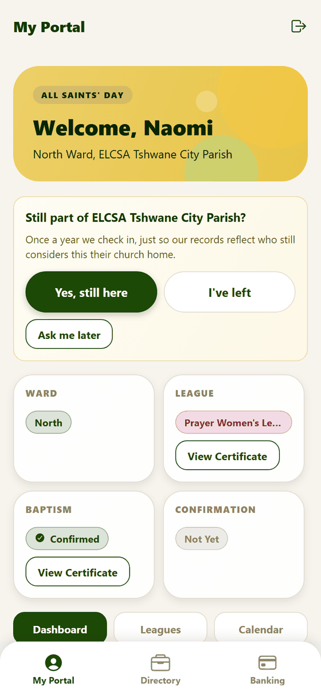

Once a year, if you haven't been using the app for a while, the portal asks **"Still part of ELCSA Tshwane City Parish?"** This helps the office keep the registry accurate.

| Button | Meaning |
|---|---|
| **Yes, still here** | You are still part of the parish. The question goes away for a year. |
| **I've left** | You tell the office you are no longer part of the parish. (You can still use the app.) |
| **Ask me later** | Hides it for now. |

If you use the app regularly you will rarely see it.

### Birthday greeting

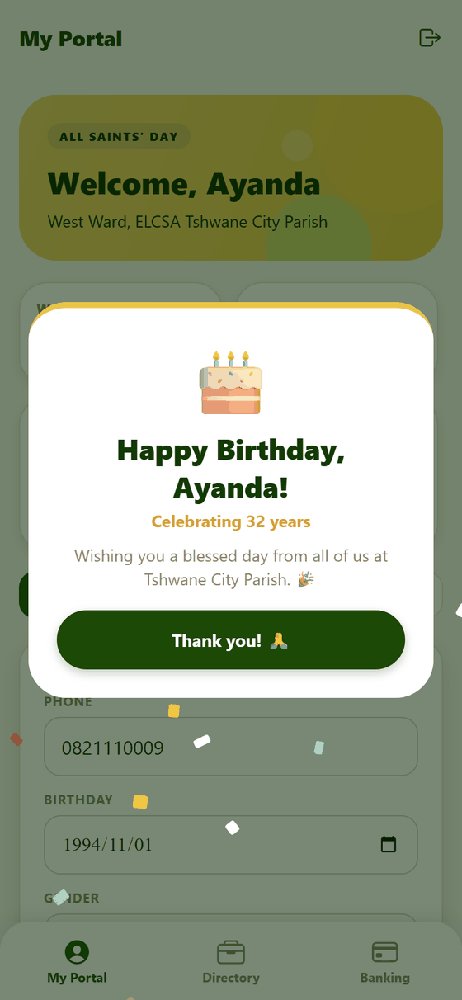

On your birthday the app opens with a greeting and a little confetti. Tap **Thank you!** to carry on. It appears once that day.

## The Dashboard section

The full portal on a phone, in one long picture:

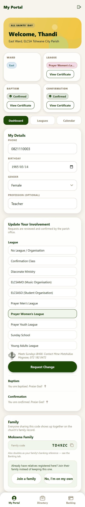

Scrolling down you will find these cards, in order:

### My Details

Your **phone**, **birthday**, **gender** and **profession**. Your profession is optional; if you add one you appear in the [member directory](05-parish-life.md#directory) so other members can find you.
Change a value and press **Save Phone** or **Save Profession** (the birthday and gender save when you pick them).

### Update your involvement

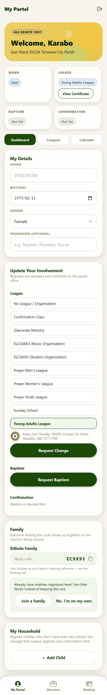

This is where you ask the parish for something. Everything here is a **request**; the office reviews it.

- **League.** Pick a league from the list (or "No League / Organisation") and press **Request Change**. You can add a short reason and, optionally, photos of your baptism and confirmation certificates.
  Tapping a league shows a short description of it.
- **Baptism.** If you aren't baptised, press **Request Baptism**.
- **Confirmation.** If you are baptised but not confirmed, press **Request Confirmation**.

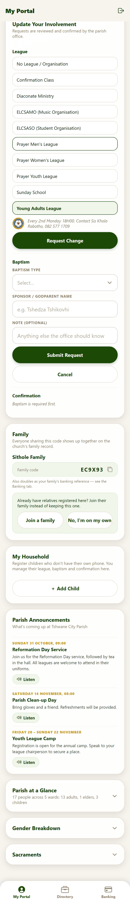

*Requesting baptism: say whether it is an infant or adult baptism, name your sponsor or godparent, and add a note if you like, then press **Submit Request**.*

Confirmation asks for a **mentor** (optional) and lets you attach a photo of your baptism certificate if you were baptised somewhere else. A photo is only supporting
evidence — nothing is blocked if you don't have one.

While a request is waiting, the card shows **"Pending"** and a **Cancel Request** button, in case you change your mind.

### The ceremony date

After the office approves a baptism, confirmation or league request, they suggest a **date**. You will see a card at the top of your portal:

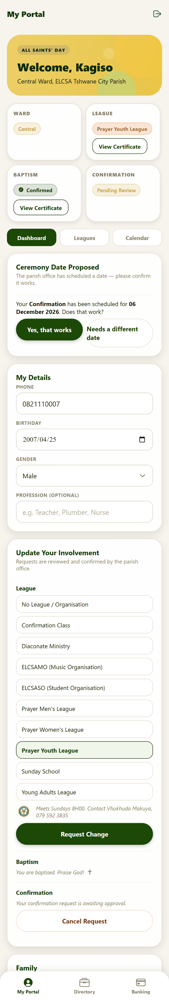

*"Ceremony Date Proposed — Your Confirmation has been scheduled for 06 December 2026. Does that work?"*

- **Yes, that works** — the request is completed, your record is updated, and the ceremony is added to the church calendar.
- **Needs a different date** — your request stays with the office, who can suggest another date. The app sends no message, so it helps to let them know in person.

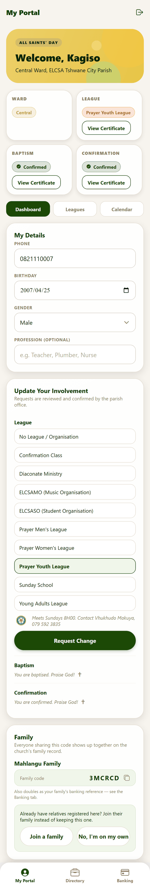

*After accepting, the status changes — here the confirmation now shows as done.*

(For a child, the parent sees this card and answers on the child's behalf.)

### Family and household

The **Family** and **My Household** cards are covered in [Family and household](03-family-and-household.md).

### Parish announcements

The latest news for the whole church and for any league you belong to, with the date and details. Tap **Listen** under an announcement to hear it read aloud. If there are
more than three, **Show all** expands the list. See [Parish life](05-parish-life.md).

### Parish at a Glance

Three collapsed sections — **Parish at a Glance** (people by ward), **Gender Breakdown** and **Sacraments** — that open when tapped. They show real numbers for the whole parish
and no names.

## The Leagues section

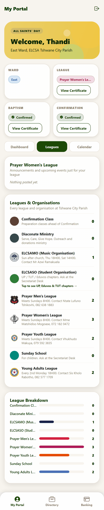

- **Your league** — its name, description and, if it has them, upcoming events and announcements just for that league.
- **Leagues & Organisations** — every league with a short description and how many members it has.
- **League Breakdown** — a bar chart of members per league.

## The Calendar section

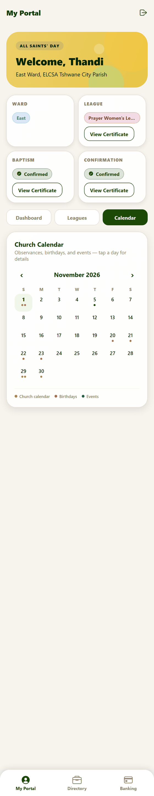

The **church calendar**: a month view with the church year (Lent, Easter, Pentecost, Advent and more — worked out automatically each year), parish events, ceremonies and **upcoming birthdays**.
Use the arrows to change month, and tap a highlighted day to see what is on.

## Other tabs

| Tab | See |
|---|---|
| **Directory** | [Parish life → Directory](05-parish-life.md#directory) |
| **Banking** | [Parish life → Banking and giving](05-parish-life.md#banking-and-giving) |

Sign out with the icon at the top right.
