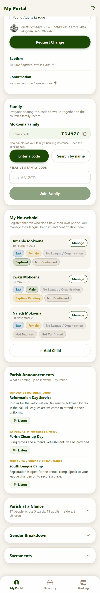
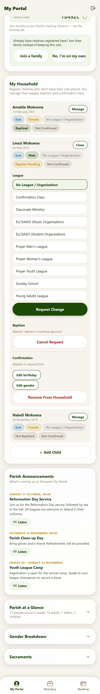
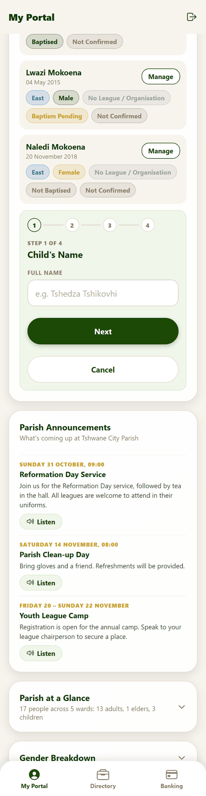

# 3. Family and household

**For:** members, especially parents. The parish keeps families together in its records, and children who don't have their own phone are registered under a parent.

There are two separate ideas, shown in two cards on your portal:

| Card | What it is |
|---|---|
| **Family** | The group of people who share a family record — usually relatives who each have their own login. |
| **My Household** | The **children** you look after who don't have a phone. You manage them from your account. |

## Your family

*The **Family** card. Here the member's family is "Mokoena Family" with its code, and she is being offered the chance to join a relative.*

### How you get a family

You don't have to do anything. When you register, the app looks for someone already registered with **your surname in your ward** and puts you in their family. If nobody matches, you get a family of your own.
Matches the app made on its own are checked by the office afterwards (see [Requests & families](07-admin-requests-and-families.md#families)), so a wrong match is easy to fix.

Every family has a short **family code**, shown on the card with a copy button. Anyone who enters your code joins your family.

#### Choosing your own code
The code starts as six random characters, but anyone in the family can press **Choose my own code** and pick one the whole family will remember: **6 to 12 letters or numbers**, no spaces or symbols (for example `MOKOENA2026`). Press **Save code**. If someone else already uses it you are asked to choose another. Your old code stops working at once; people already in the family are not affected. Because **anyone who enters the code joins your family**, choose something relatives can remember but strangers cannot guess, not just your surname. The code is also the family's banking reference, so tell anyone who pays by EFT if you change it.

### Joining a relative's family

If a relative registered first and you ended up in separate families, press **Join a family**. You can find them two ways:

| Option | How |
|---|---|
| **Enter a code** | Type your relative's family code and press **Join Family**. A code is a deliberate, exact match, so it takes effect straight away. |
| **Search by name** | Start typing your relative's name. Matching members from your congregation appear with their ward; tap the right one and confirm. |

If the family you are in is fine, choose **No, I'm on my own**.

> Members cannot rename, delete or reshuffle families themselves. That is done by the office — ask them if a family needs correcting.

## Your household (children without a phone)

*My Household. Each child shows their ward, gender, league and baptism and confirmation status. **Manage** opens one child's details, and **+ Add Child** registers another.*

Everything you can do for yourself, you can do for a child you have registered:

- Ask for a league, baptism or confirmation for them (the same forms as on [your own portal](02-your-portal.md#update-your-involvement)).
- Change their birthday and gender (**Edit birthday**, **Edit gender**).
- View their certificate once a baptism or confirmation is on record ([Certificates](04-certificates.md)).
- **Remove From Household** if you registered them by mistake.

The office sees your children in the registry with your name beside them as guardian; any ceremony date they suggest comes to **you** to accept.

### Adding a child

Press **+ Add Child**. It is a short four-step form:

1. **Child's Name**
2. **Birthday** (optional)
3. **Ward & Gender**
4. **Sacraments & League** — whether they are already baptised or confirmed, and any league they already belong to. As at your own registration, this is recorded immediately and needs no approval.

Press **Next** between steps and **Cancel** to stop.

Children count towards the parish totals (as "children" — under 18). A child's **name and birthday also appear in the upcoming-birthdays list** that other signed-in members can see, marked with a small child icon, just like an adult's. Their other details (ward, league, sacraments, certificates) are visible only to you and the office.

## If you leave or move

Removing yourself, or changing your family, is done by the office. Ask them; they can move you to another family or remove a record entirely. See
[DEPLOYMENT.md → Removing someone completely](../DEPLOYMENT.md#removing-someone-completely) for what that does to your sign-in.
