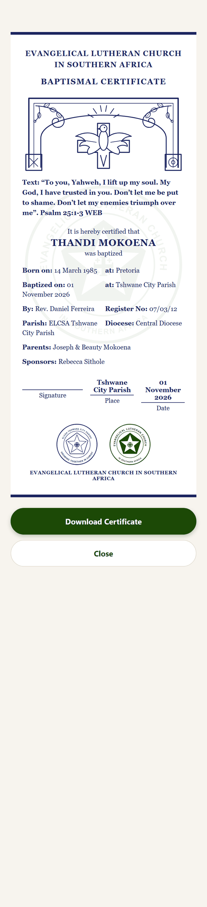
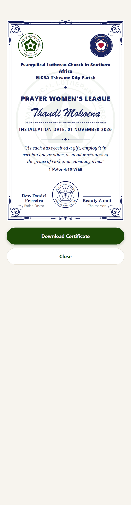
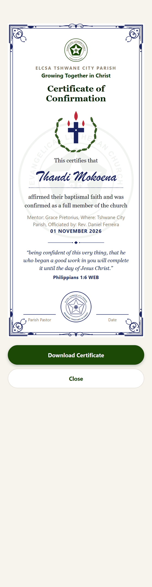

# 4. Certificates

**For:** members (to view and save their certificates) and the office (to know what each certificate needs).

The app produces three certificates, each laid out like the parish's paper ones and drawn from scratch so they stay sharp when printed: a **baptism**, a **confirmation** and a **league installation** certificate. Each always carries a **Bible verse**.

## Getting yours

1. On [My Portal](02-your-portal.md), find the card — **Baptism**, **Confirmation** or **League**.
2. Once it is on record, a **View Certificate** button appears on that card. (For a child, it is on the child's entry under **My Household → Manage**.)
3. The certificate opens full screen. Press:
   - **Download Certificate** on a computer — saves a picture (PNG) named after the person and certificate, or
   - **Save / Share Certificate** on a phone — opens the phone's share sheet, so you can save it to photos or send it, for example on WhatsApp.
4. **Close** returns to your portal.

The saved picture is high resolution (about 1440 pixels wide from a computer), so it prints well.

## The baptism certificate

Follows the parish's paper baptismal certificate. Top to bottom: the church's name, **BAPTISMAL CERTIFICATE**, a drawing of a cross and dove under an arch, the **verse**, then
*"It is hereby certified that … was baptized"* with the details in two columns, and signature, place and date lines above the parish seal and the ELCSA crest.

| Printed | Comes from |
|---|---|
| Name, date of birth | The member's record |
| Baptized on | The confirmed ceremony date (or the date it was recorded) |
| Place, officiant, sponsors | What was entered at registration or in the baptism request |
| **Register No., Diocese, Parents, Place of birth, Verse** | **Added by the office** — see below |

Rows with nothing recorded are simply left out, so a certificate is never printed with empty labels.

**The office adds the extra details:** open the person in the registry → **Edit Certificate Details** ([Registry guide](06-admin-dashboard-and-registry.md#a-members-profile)).
Type a verse reference such as `Psalm 25:1-3` and press **Look Up** to fill in the text, or type your own. If you leave the verse blank, the certificate prints Galatians 3:27.

## The league installation certificate

Shows the church and parish name and address, the league's emblem, the **league name**, the member's name in script, the **installation date** and the verse. Two signature lines sit either side of the parish seal.

| Printed | Comes from |
|---|---|
| League name, installation date | The league and the confirmed ceremony date |
| **Chairperson and Parish Pastor names, verse** | **Set once per league** under the league's *Certificate Details* ([League guide](08-admin-announcements-and-leagues.md#certificate-details)) |
| Parish name and address | **Congregation Settings** |

Every member of a league shares the same chairperson, pastor and verse. If the league has no verse the certificate prints 1 Peter 4:10 (the example above, from the Prayer Women's League, which has none set).

## The confirmation certificate

A new design in the same style: the crest, **Certificate of Confirmation**, an emblem of a cross with three flames of the Holy Spirit inside a wreath, the member's name, a line such as
*"affirmed their baptismal faith and was confirmed as a full member of the church"*, the mentor and place if recorded, the date, the verse, and lines for the parish pastor and the date above the parish seal.
The default verse is Philippians 1:6.

There is no paper template for this one yet, so the layout is the app's own design.

## Good to know

- **Verses.** Admin-chosen verses are free text. The built-in defaults are in the *World English Bible*, a public-domain translation; a verse the office types can be from any translation they are licensed to use.
- **A certificate is only as complete as the record.** If a name, date or parent's name is wrong, ask the office to correct the record — then open the certificate again.
- **Nothing is stored as an image.** The certificate is drawn fresh each time from the record, so corrections show immediately.
