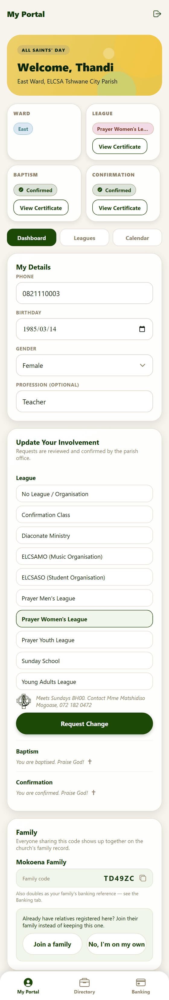
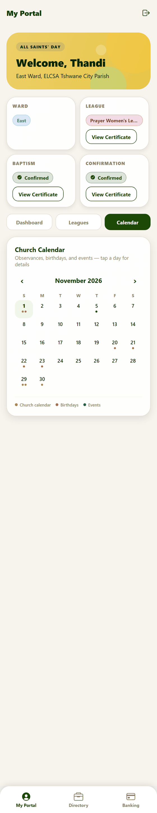
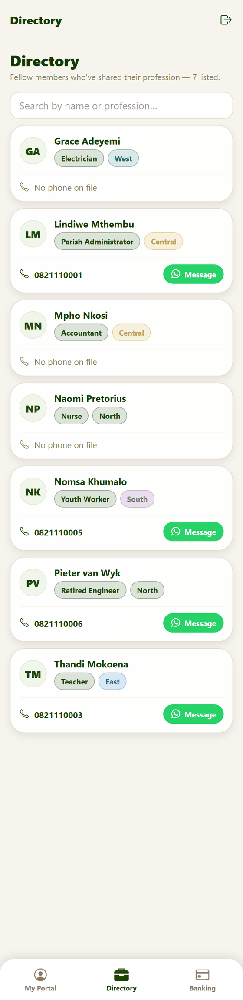
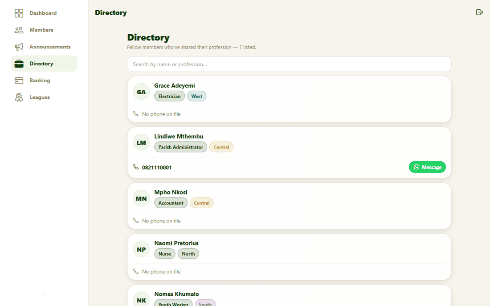
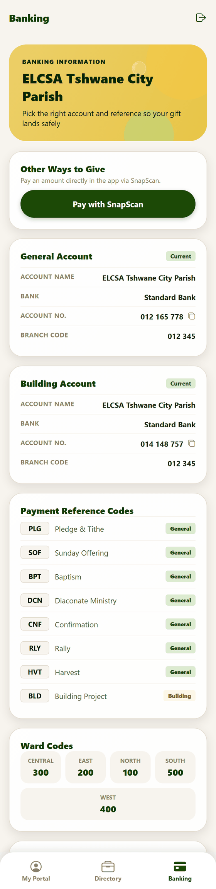
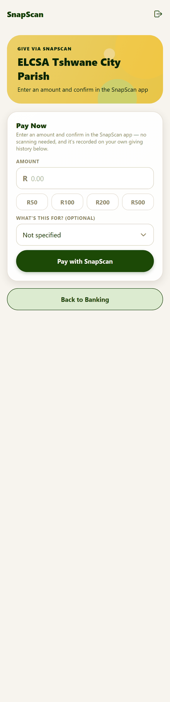

# 5. Parish life: news, calendar, directory and giving

**For:** members. These are the shared parts of the app — what is happening, who is who, and how to give.

## Announcements

News from the office and from leagues appears on [My Portal](02-your-portal.md) under **Parish Announcements**, newest first.

Each announcement shows a **date or time** (free text such as "Sunday 31 October, 09:00"), a **title**, the **details** and sometimes a **poster** picture.

- **Listen** reads it aloud — useful for people who find reading small print difficult.
- **Everyone in the congregation can read every announcement**, including ones posted for a particular league. Posting for a league makes it appear on **that league's page** (the Leagues section of the portal and the league admins' tools); it does not hide it from other members. Don't put anything private in an announcement.
- The office posts them — see [Announcements & leagues](08-admin-announcements-and-leagues.md).

## The calendar and birthdays

On [My Portal](02-your-portal.md#the-calendar-section), the **Calendar** button opens a month view.

It combines:

- the **church year** — Lent, Easter, Pentecost, Advent and the other seasons, worked out automatically for any year;
- **parish and league events** and **scheduled ceremonies** (baptisms, confirmations, installations), which the office adds;
- **upcoming birthdays** in the congregation, with a child icon beside a child's name.

Tap a highlighted day to see everything on it.

## Directory

Other members who have chosen to share their **profession** are listed here, with their ward and phone number. **You only appear if you add a profession** to your own details — that is the opt-in.

Each entry has:

- a **phone number** — tap it to call;
- a green **Message** button that opens WhatsApp with that person (shown when they have a number).

On a computer the directory uses the wider screen:

The directory is limited to your own congregation. The **Privacy Policy** in the app (on the front and sign-in screens) explains what is shared.

## Banking and giving

The **Banking** tab tells you exactly where to send money so it reaches the right place:

- **Bank accounts** — for example the General Account and Building Account, each with the bank, account number and branch code. Tap the small copy icon beside a number to copy it.
- **Payment Reference Codes** — short codes such as **PLG** (Pledge & Tithe), **SOF** (Sunday Offering) and **BPT** (Baptism). Put the code in the reference field of your deposit.
- **Ward Codes** and the **reference format** — how to include your ward so the office can trace the deposit.

### Giving through SnapScan

If the parish has set up SnapScan, a **Pay with SnapScan** button appears at the top. It leads to:

1. Choose an **amount** — tap R50, R100, R200 or R500, or type your own.
2. Optionally choose **what it is for** (a payment code).
3. Press **Pay with SnapScan**. SnapScan opens to confirm and take the payment.

The app records the payment once SnapScan confirms it. Your card or bank details go to SnapScan, never to this app. If you don't see the button, the parish hasn't switched SnapScan on yet — use the bank details above.
