# 6. Admin: the dashboard and the registry

**For:** the parish office (congregation admins). Everything here needs an admin account. The sample screens use the [test accounts](../TEST_ACCOUNTS.md) — sign in as `admin@example.com`.

You are looking after other people's personal information. Open only what you need, and don't share screenshots of the registry outside the office.

## Finding your way around

On a computer the navigation is a sidebar down the left; on a phone it is a bar along the bottom (the first two are shortened to **Home** and **News**).

| Tab | For |
|---|---|
| **Dashboard** | Live numbers for the whole parish |
| **Members** | The registry: people, requests, families, activity and settings |
| **Announcements** | News and events — [guide 8](08-admin-announcements-and-leagues.md) |
| **Directory** | The members who shared their profession |
| **Banking** | Bank accounts and giving — [guide 9](09-admin-congregation-settings.md) |
| **Leagues** | Tools for every league — [guide 8](08-admin-announcements-and-leagues.md) |

An admin sees no *My Portal* tab: admins land on the Dashboard instead.

## The Dashboard

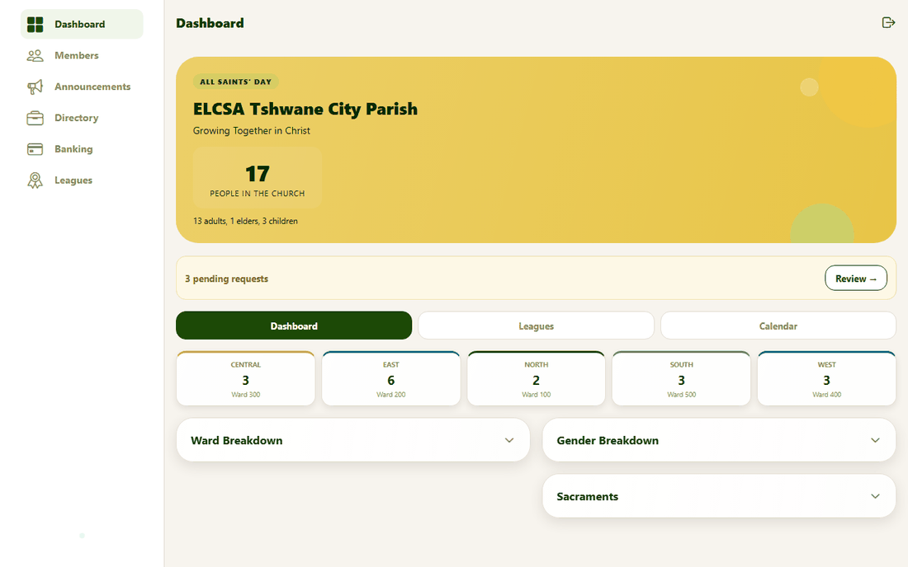

**The banner** shows how many **people are in the church**, split into adults, elders (60 and over) and children (under 18). Generic league logins are not counted. Children are included.

**The yellow bar** — "*4 pending requests — Review →*" — appears whenever requests are waiting. **Review →** takes you to them.

**Ward cards.** One per ward with its head-count and its ward code (the number used in payment references).

Three buttons switch the view: **Dashboard**, **Leagues**, **Calendar**.

### Dashboard — breakdowns

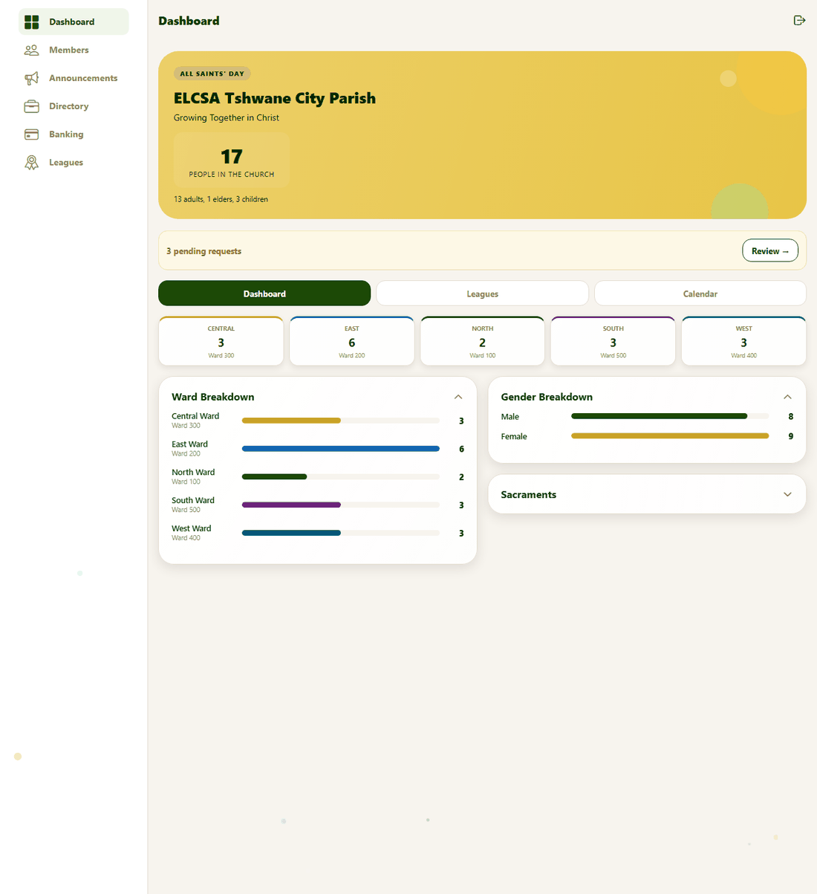

Tap a heading to open it:

- **Ward Breakdown** — people per ward.
- **Gender Breakdown** — male and female counts.
- **Sacraments** — how many people have been baptised and confirmed.

These are counts only, with no names.

### Leagues

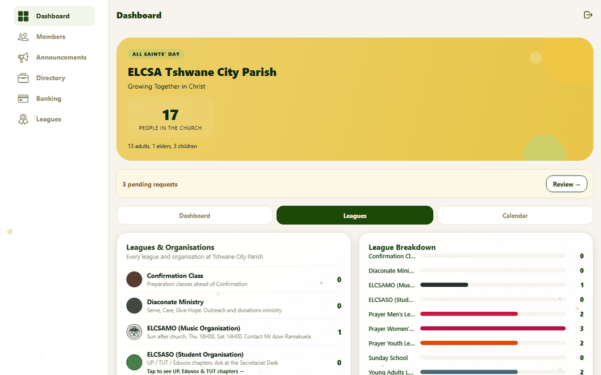

**Leagues & Organisations** lists every league with a short description and its member count, next to a bar chart (**League Breakdown**).

### Calendar

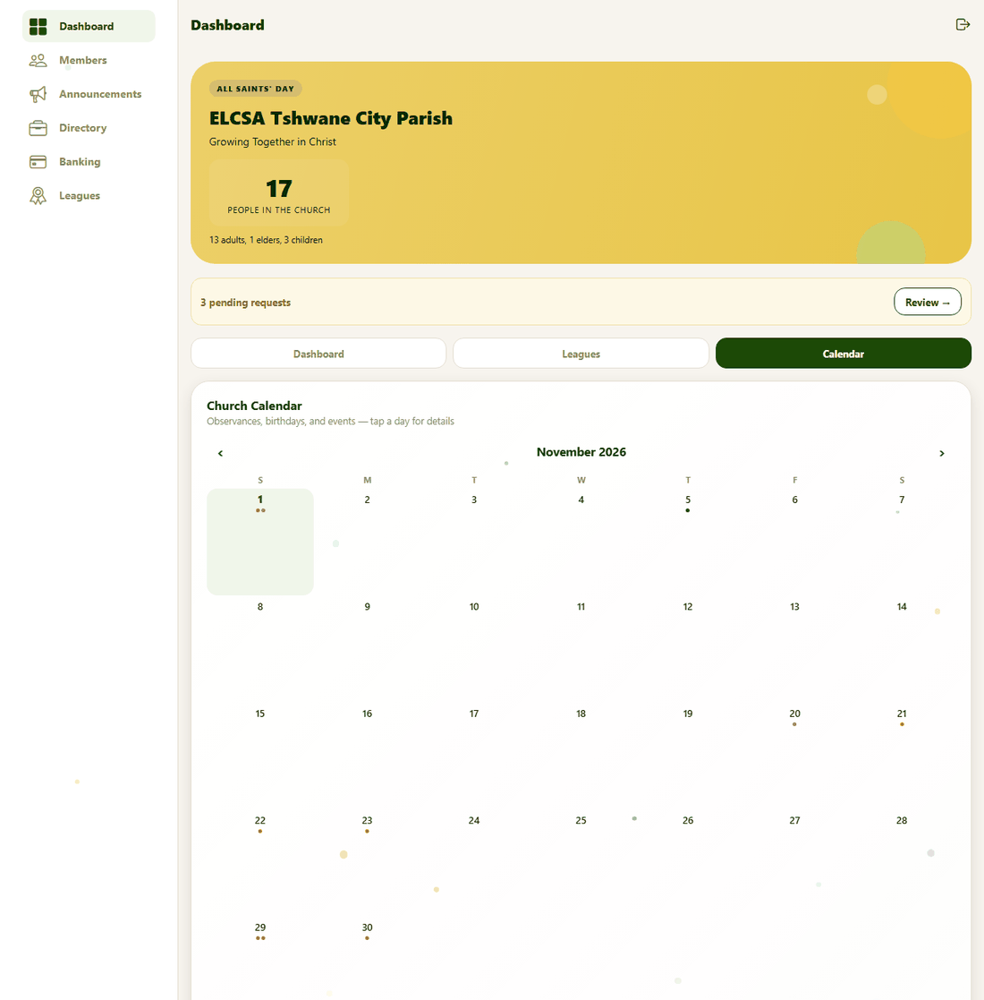

The church year, parish and league events, scheduled ceremonies and upcoming birthdays, with a month view you can page through.

## The registry (Members tab)

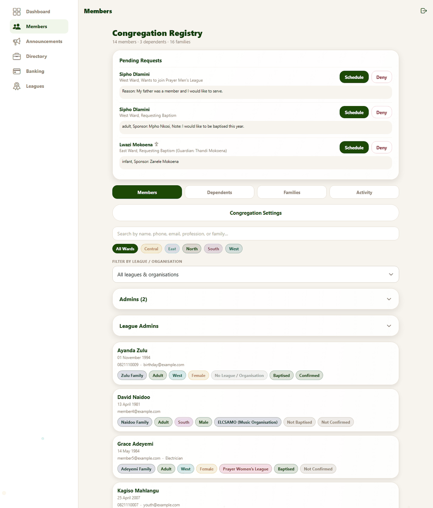

At the top, **Congregation Registry** shows the totals (members, dependents, families). Below it:

1. **Pending Requests** — baptisms, confirmations and league requests waiting for you. Handled in [guide 7](07-admin-requests-and-families.md).
2. **Four view buttons:** **Members**, **Dependents**, **Families**, **Activity**.
3. **Congregation Settings** — see [guide 9](09-admin-congregation-settings.md).
4. A **search box** (name, phone, email, profession or family), **ward buttons**, and a **league / organisation** filter. They combine, so you can ask for, say, "everyone in East Ward who belongs to the Prayer Women's League".
5. **Admins** and **League Admins** (collapsed lists) — see below.
6. The list itself: each person shows their name, birthday, email, phone and profession, with small tags for family, age group, ward, gender, league and sacraments.

The list loads as you scroll; use the search box to jump to someone.

### A member's profile

Tap someone to open their profile:

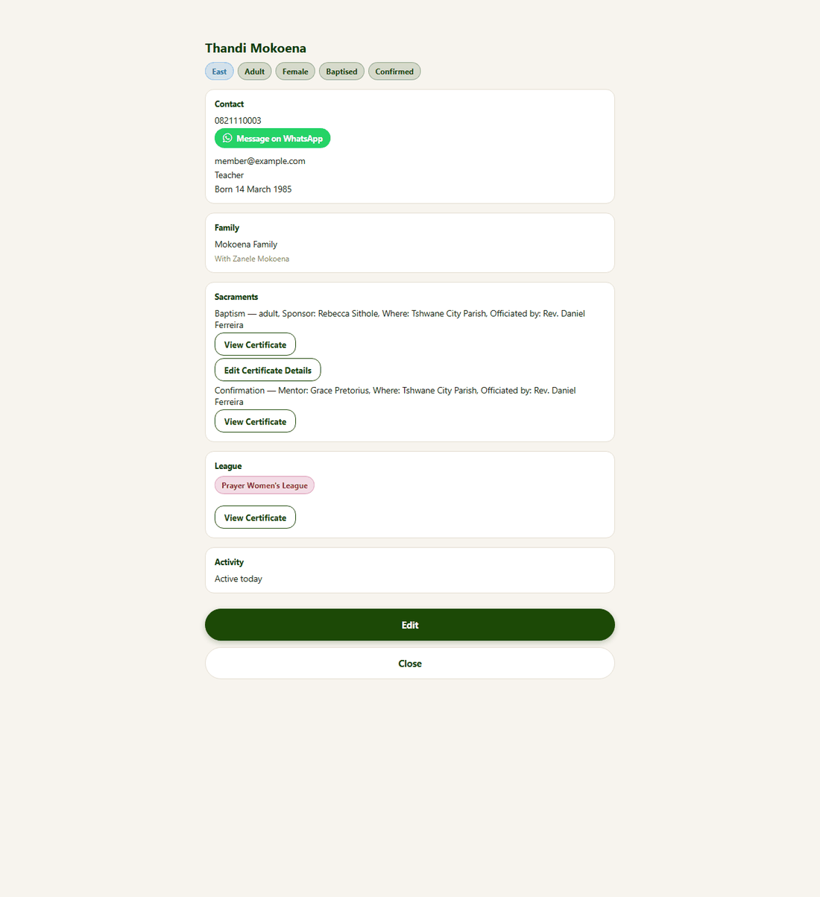

- **Contact** — phone (with a green **Message on WhatsApp** button), email, profession and date of birth.
- **Family** — their family name and who else is in it.
- **Sacraments** — the baptism and confirmation details on record, with **View Certificate** buttons, and **Edit Certificate Details** for baptisms (register number, diocese, parents, place of birth, verse — see [Certificates](04-certificates.md#the-baptism-certificate)).
- **League** — their league and its certificate.
- **Activity** — when they last used the app.
- **Edit** and **Close**.

### Editing a member

Press **Edit**:

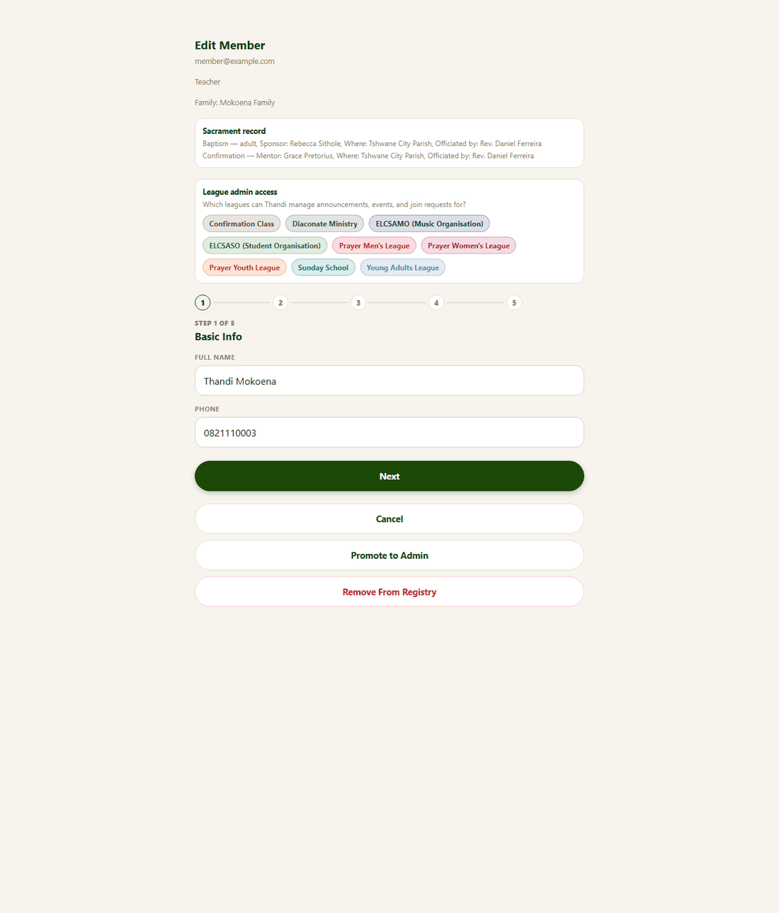

At the top you see their email, profession, family and the **sacrament record** as the person entered it. **League admin access** lets you tick the leagues this person may administer ([guide 8](08-admin-announcements-and-leagues.md#making-someone-a-league-admin)).

Below it, a five-step form, advanced with **Next** and finished with **Save Changes** on the last step:

| Step | Fields |
|---|---|
| **Basic Info** | Full name, phone |
| **Birthday, Gender & Ward** | |
| **League / Organisation** | Which league they belong to |
| **Sacraments** | Whether they are baptised and confirmed |
| **Family** | Move them to another family |

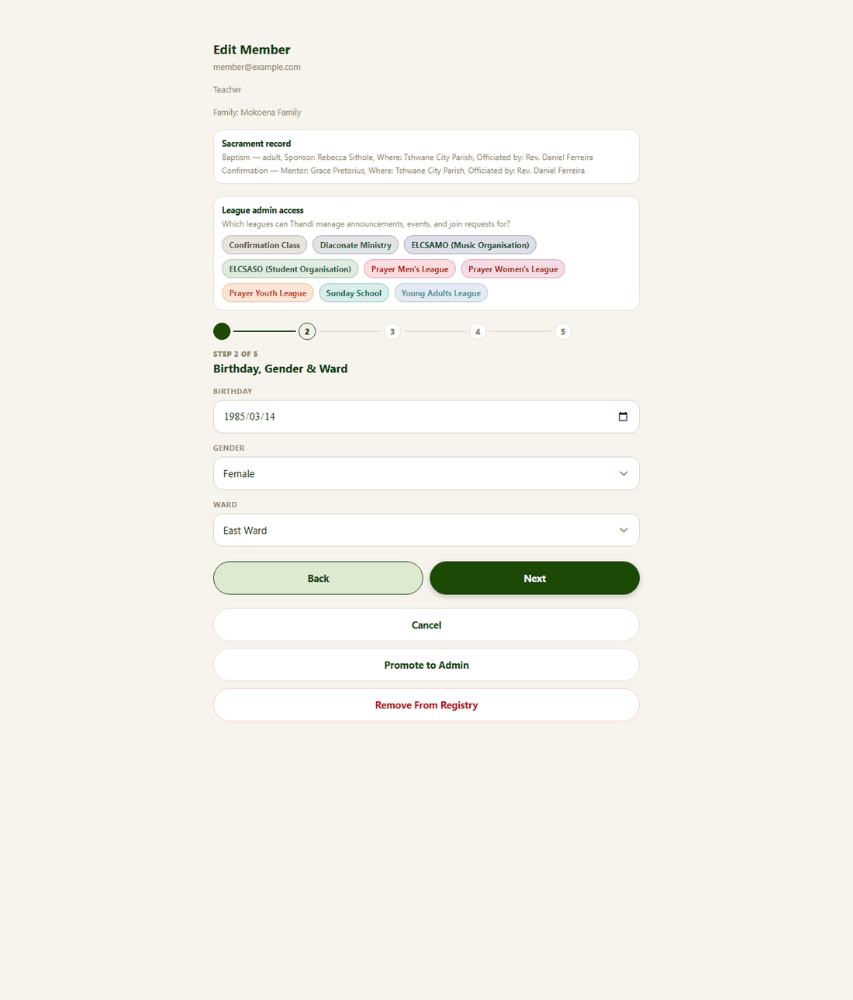

Under the form are the buttons you should treat with care:

- **Promote to Admin** — gives them full office access. Keep the number of admins small.
- **Remove From Registry** — deletes their record **and their children**. The app warns you by name first. It does **not** delete their sign-in; see [Removing someone](../DEPLOYMENT.md#removing-someone-completely).

### Dependents

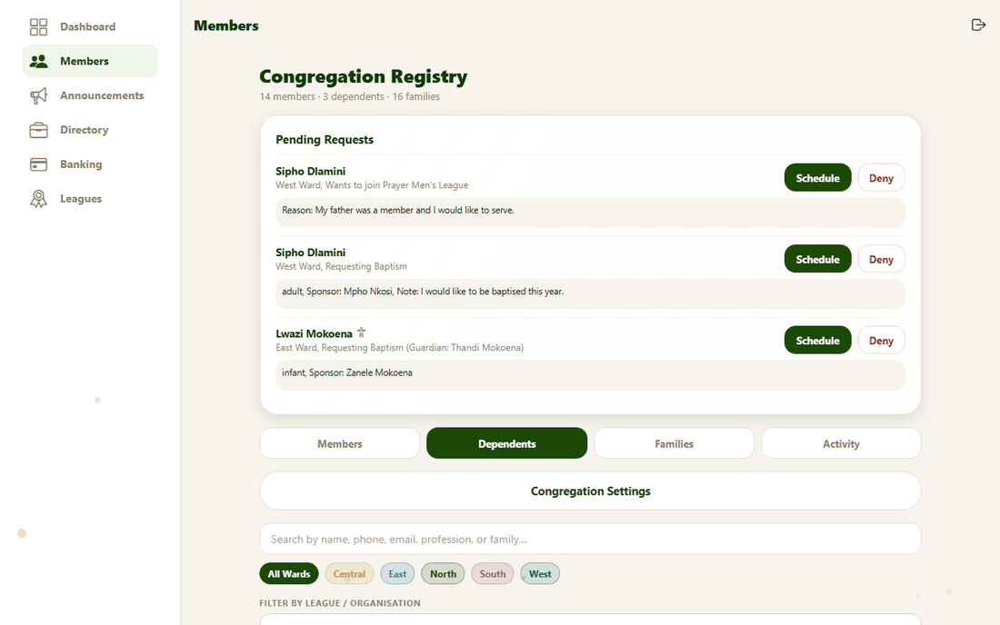

The **Dependents** button lists children registered by their parents, with the guardian's name beside each. Search and filters work the same way.

Tap a child to edit them:

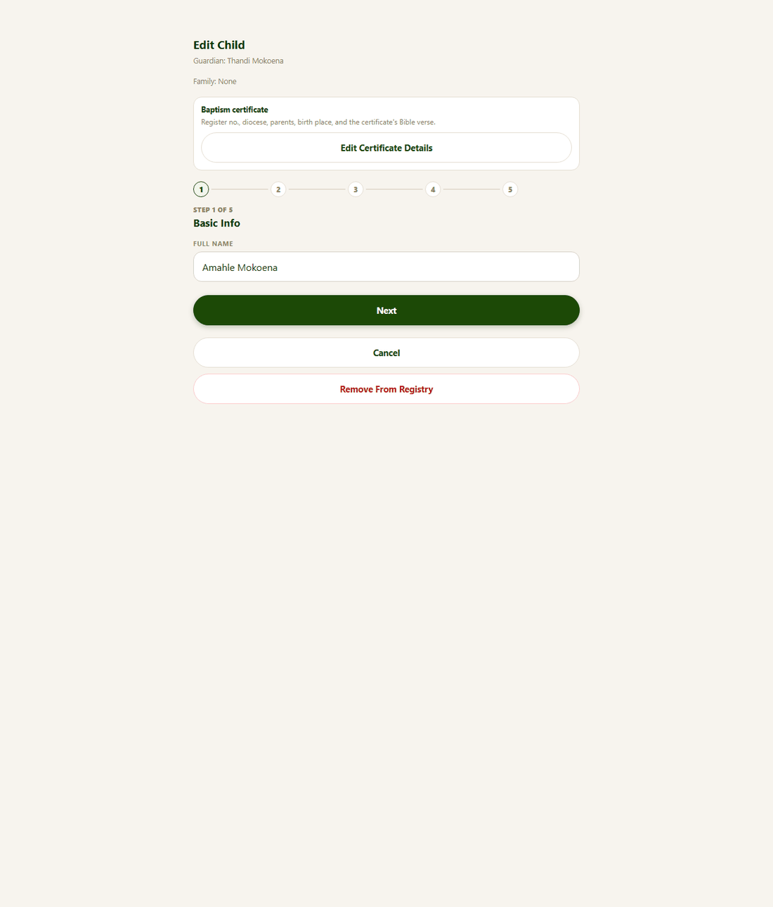

The same five steps as an adult (Basic Info, Birthday/Gender/Ward, League, Sacraments, Family), plus **Edit Certificate Details** for a baptised child and **Remove From Registry**.

### Activity

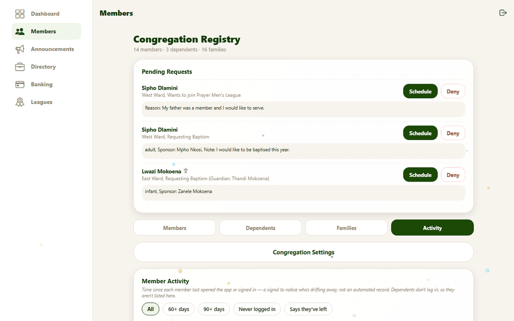

**Member Activity** shows how long since each adult last opened the app. It is a signal to notice who is drifting away, not an automated record. Children don't sign in, so they aren't listed.

Filter with **All**, **60+ days**, **90+ days**, **Never logged in**, or **Says they've left**:

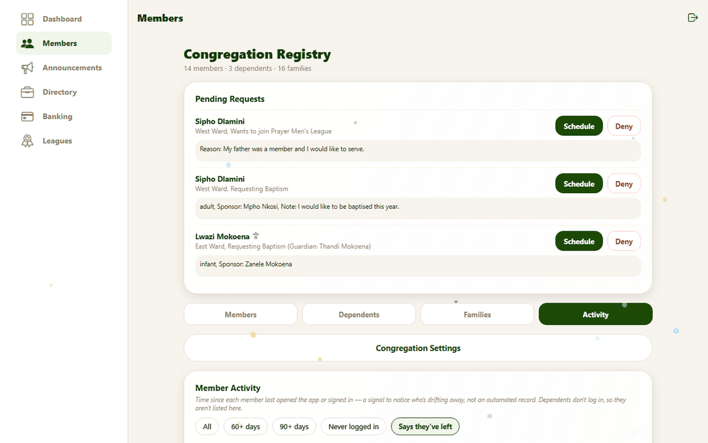

*"Says they've left" lists people who answered **I've left** to the yearly check-in, with the date they said so. Nothing is deleted automatically — the office decides what to do.*

### Admins and league admins

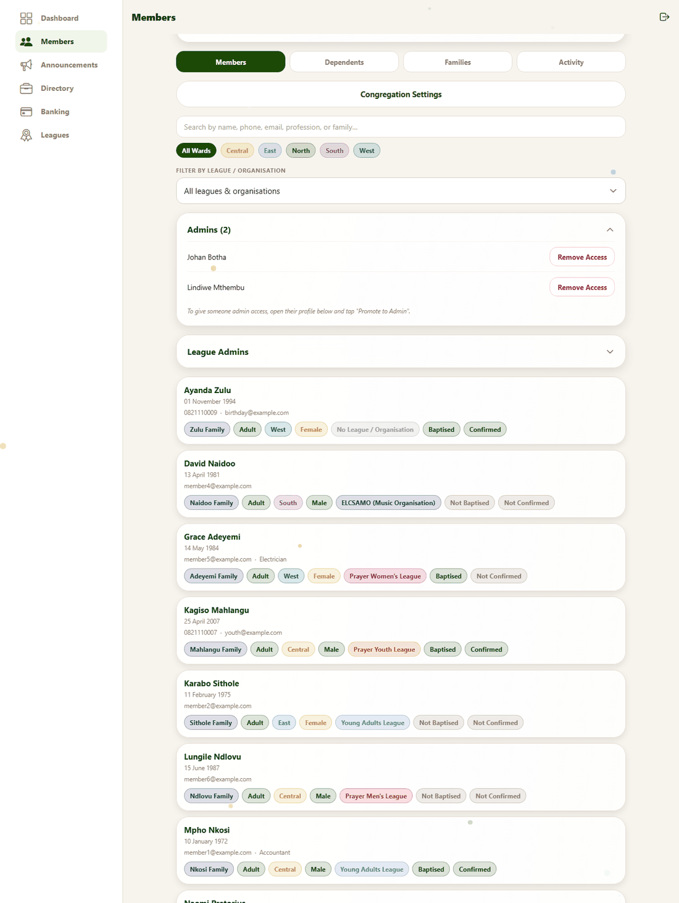

Open **Admins** to see everyone with full access, each with a **Remove Access** button (the last admin cannot be removed). **League Admins** lists who administers which league, with **Remove** next to each. To *add* either, open the person and use **Promote to Admin** or **League admin access**.

## On a phone

The same screens work on a phone, with the sidebar becoming a bottom bar and cards stacking in one column:

| Dashboard | Registry |
|---|---|
| 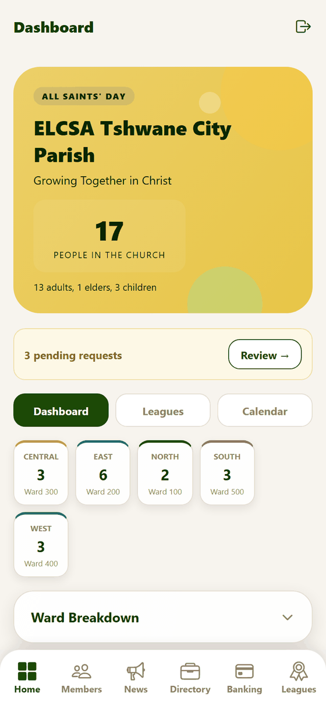 | 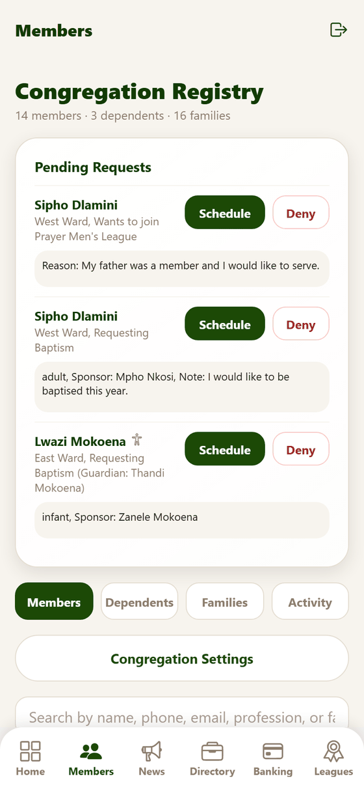 |

More about the layouts: [Phone, desktop and installing](10-phone-desktop-and-install.md).
