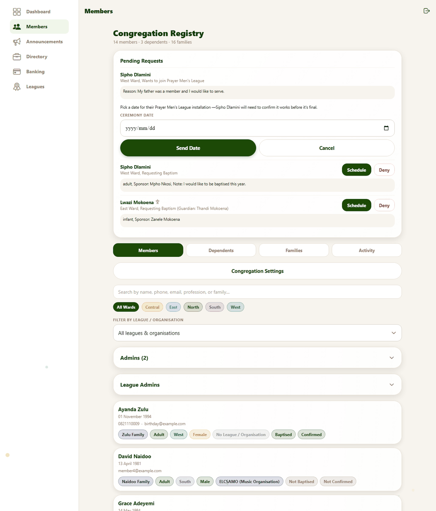
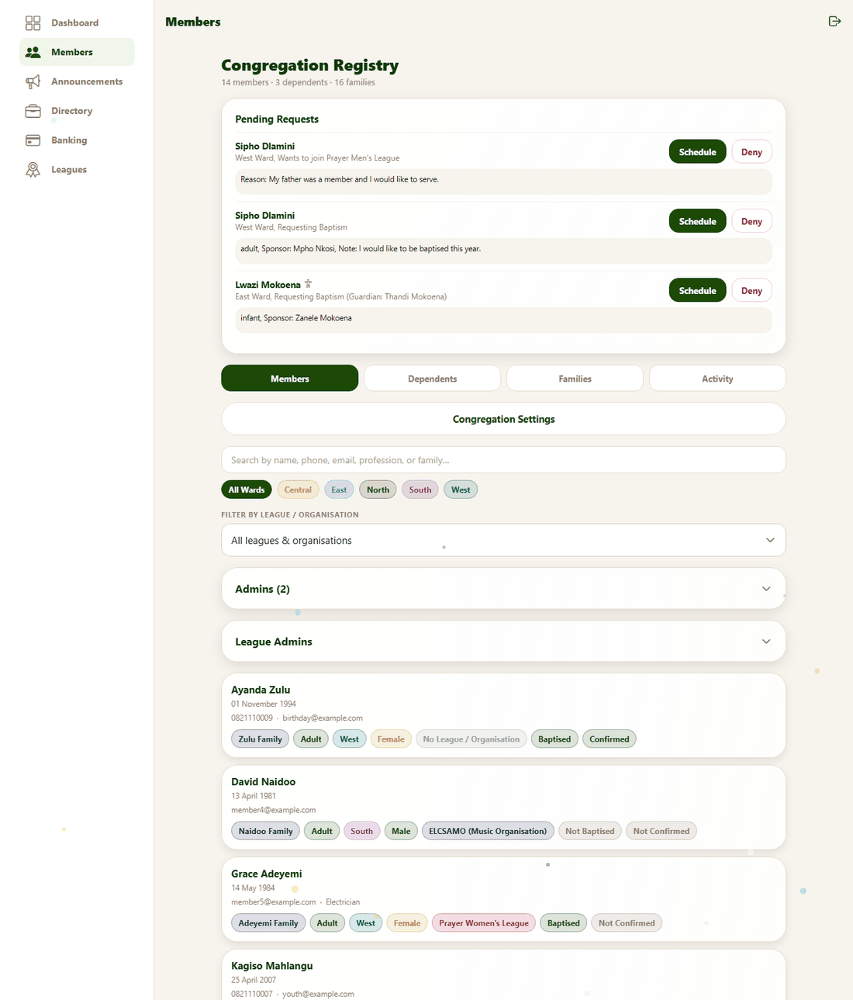
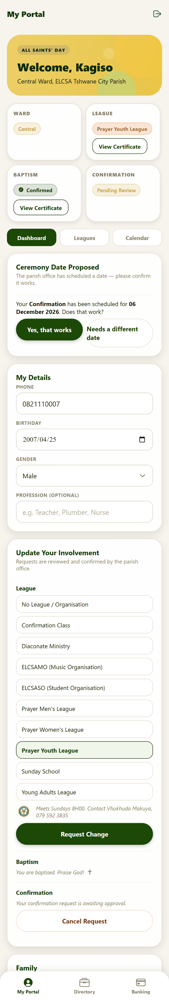
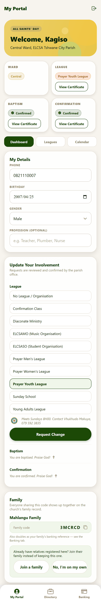
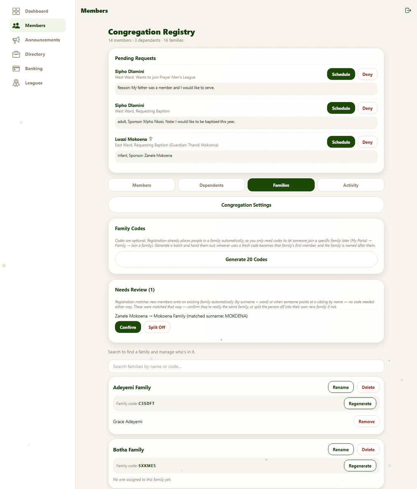

# 7. Admin: requests, ceremonies and families

**For:** the parish office. This guide follows a request from the moment a member asks for something to the moment it appears on their certificate, and then covers keeping families tidy.

Sample screens use the [test accounts](../TEST_ACCOUNTS.md): `newmember@example.com` (has pending requests), `youth@example.com` (a confirmation request to schedule), and `admin@example.com`.

## How a request works

Members ask for three kinds of things from their portal ([see how](02-your-portal.md#update-your-involvement)): **baptism**, **confirmation**, and **joining or changing a league**. Parents can ask on behalf of their children.

```
Member asks  →  you review it  →  you propose a date  →  member accepts  →  done
                       └── or Deny (immediate)          └── or "needs a different date" → propose another
```

Nothing is final until the member accepts a date. That way a ceremony is never recorded for someone who can't attend.

## Pending Requests


Open **Members**. Waiting requests are listed in the **Pending Requests** card at the top. Each shows:

- the **person's name** and ward, what they are asking for (*Requesting Baptism*, *Wants to join Prayer Men's League*, *Requesting Confirmation*);
- what they wrote — the baptism type and sponsor, the confirmation mentor, or their reason for joining a league, and any note;
- for a child, a small child icon and **(Guardian: name)**.

If a request came with certificate photos they can be viewed from the person's profile.

Each request has two buttons: **Schedule** and **Deny**.

### Scheduling a ceremony

Press **Schedule**. A date box opens under that request:



*"Pick a date for their Prayer Men's League installation — Sipho Dlamini will need to confirm it works before it's final."*

1. Choose the **Ceremony date**.
2. Press **Send Date** (or **Cancel**).

The request stays in your list while it waits for the member:



### What the member sees



The member's portal shows **Ceremony Date Proposed** with the date and two buttons. (For a child, the parent sees it.)

- **Yes, that works** — the request is **completed automatically**: their record changes (baptised, confirmed, or in the league), a **calendar entry** for the ceremony is created — shared if several people have the same date — and the **certificate** becomes available. Nothing more for you to do.
- **Needs a different date** — that date is marked declined and the request **stays in your list**, so you can press **Schedule** again with another date. The app sends no message, so it is worth a quick word with the member.



### Denying a request

**Deny** declines immediately and takes it off the list. There is no date step. The app does not send the member a message — tell them yourself if they should know why.

> The details a member entered (sponsor, mentor, place and officiant) are **kept** after approval so they can appear on certificates.

## League requests and league admins

League join requests are handled the same way. They also appear on the **My League** page of that league's admins, who can schedule or deny them for their own league. See [guide 8](08-admin-announcements-and-leagues.md#what-a-league-admin-sees).

## Families

Press **Families** in the registry:



### Family codes

Every family has a short code. People get one automatically when they register, so you don't *need* to hand codes out. **Generate 20 Codes** makes a batch of unused codes for cases where you want to give a family a code in advance — for example printed on a membership card. Whoever first uses a fresh code becomes that family's first member, and the family is named after them.

### Needs Review

When someone registers with the **same surname and ward** as an existing family, the app places them in it automatically. Each such match appears under **Needs Review** with the names involved:

- **Confirm** — yes, they are one family.
- **Split Off** — no; put them in a new family of their own.

(Example: Zanele Mokoena registered in East Ward, the same as Thandi Mokoena, so she appears here.)

### Unassigned

People not yet in any family are listed under **Unassigned**.

### Looking after one family

Use the search box ("Search to find a family and manage who's in it") to find a family. Each family card shows its name, its code and its members and children, with:

| Button | What it does |
|---|---|
| **Rename** (then **Save** / **Cancel**) | Change the family's name |
| **Regenerate** | Give the family a new code (the old one stops working) |
| **Delete** | Delete the family record; people in it are kept but become unassigned |
| **Remove** (beside a person) | Take that person out of this family |

Members cannot do any of this for themselves. They can only join a relative's family by code or name — see [Family and household](03-family-and-household.md).
