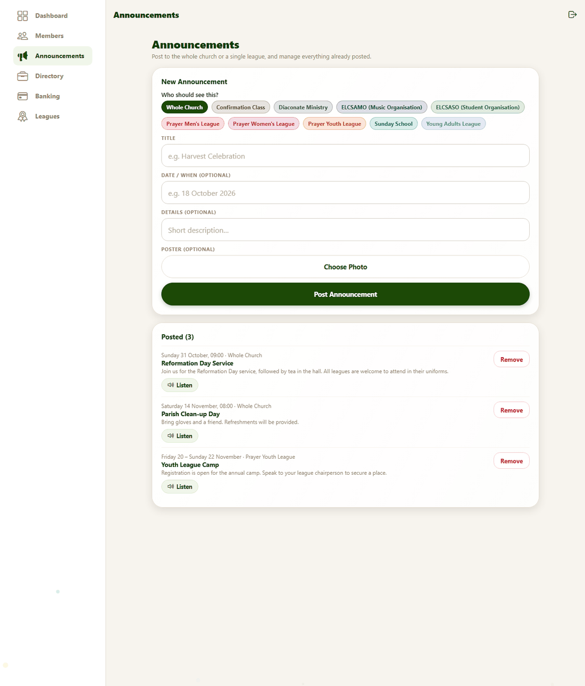
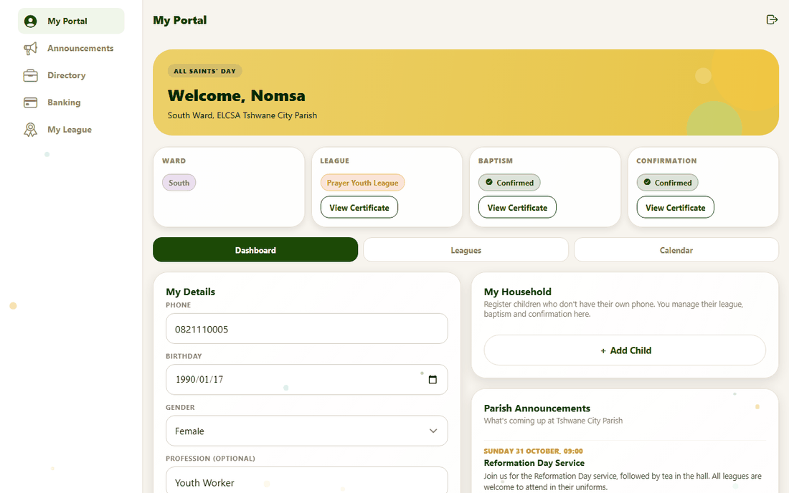
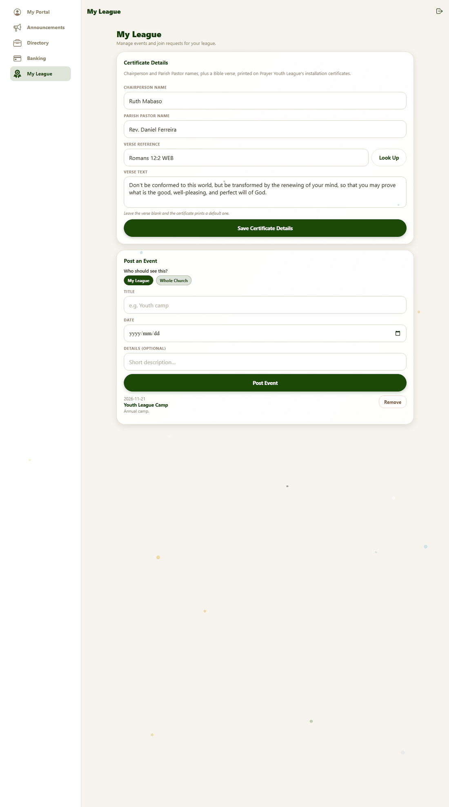
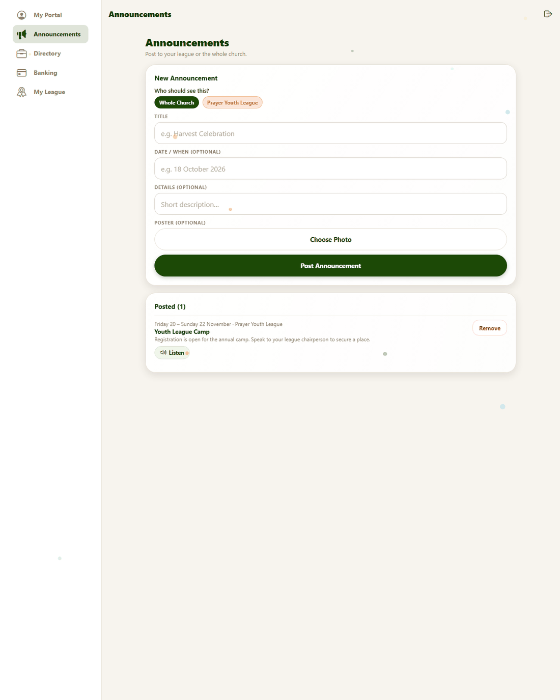
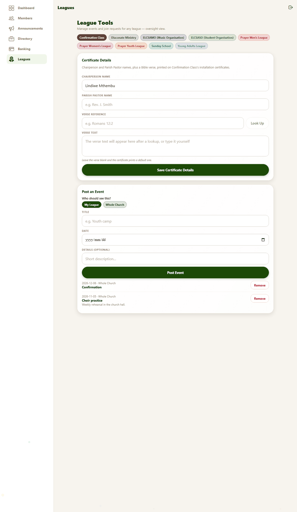

# 8. Announcements, events and leagues

**For:** the parish office and **league admins** — members given admin rights for one league only. Try it with `admin@example.com` (everything) and `leagueadmin@example.com` (one league) from the [test accounts](../TEST_ACCOUNTS.md).

## Announcements

Open **Announcements**. The top card, **New Announcement**, has:

| Field | Notes |
|---|---|
| **Post to** | **Whole Church** or one league. Pick a single choice. |
| **Title** | Required. |
| **Date / when** | Optional free text — "Sunday 31 October, 09:00" or "Every Tuesday". It is *text*, not a calendar date. |
| **Details** | Optional. |
| **Poster** | Optional picture, chosen with **Choose Photo**. |

Press **Post Announcement**. It appears at once for members and joins the **Posted** list below, where each item has **Remove** and a **Listen** button to hear how it will sound.

> **Who can read it.** Choosing a league makes the announcement appear on **that league's page**, but **every member of the congregation can still read it** in the main announcements list. Choose *Whole Church* for news everyone should see, and never put anything private in an announcement.

A congregation admin can post to the whole church or any league. A league admin can post to the whole church or **their own** league(s).

## Events

Events are dated entries on the church calendar. They are posted from the **league tools** (below). Ceremonies you schedule from the registry also appear on the calendar automatically ([guide 7](07-admin-requests-and-families.md#scheduling-a-ceremony)).

## What a league admin sees

A league admin is an ordinary member with one extra tab. In the sidebar they have **My Portal** (everything a member has), **Announcements**, **Directory**, **Banking** and **My League**.

They **cannot** see the registry, other members' details, or other leagues' tools.

### My League

*Top to bottom: **Certificate Details**, then **Post an Event**. When someone asks to join the league, a **Pending Join Requests** card appears at the top.*

#### Pending Join Requests
People who ask to join this league are listed with their reason. **Schedule** (choose an installation date, then **Send Date**) or **Deny**, exactly as in [guide 7](07-admin-requests-and-families.md#pending-requests). Children's requests show the guardian's name.

#### Post an Event
Title, **Date**, optional details, and **Post to** — **My League** or **Whole Church**. Press **Post Event**. Events appear on the calendar and in the list below, with **Remove**.

#### Certificate details
Everything printed on this league's installation certificates that isn't about the individual:

| Field | Printed as |
|---|---|
| **Chairperson Name** | The right-hand signature line |
| **Parish Pastor Name** | The left-hand signature line |
| **Verse Reference** and **Verse Text** | The verse. Type a reference like `Romans 12:2` and press **Look Up** to fetch the text, or type your own. |

Press **Save Certificate Details**. **Leave the verse blank and certificates print a default verse** (1 Peter 4:10). The change applies to all of the league's certificates, including ones already issued, the next time they are opened. See [Certificates](04-certificates.md#the-league-installation-certificate).

### The league admin's announcements

The form offers only **Whole Church** and their own league.

## What an office admin sees on the Leagues tab

The **Leagues** tab (called **League Tools**) gives the office the same tools for **any** league. A row of buttons at the top chooses the league you are working on; the forms below then act on that league. Use it to keep every league's certificate details complete and to post events for a league.

## Making someone a league admin

1. **Members** → open the person → **Edit**.
2. Under **League admin access**, tap the league(s) they should manage. Each tap takes effect immediately; a highlighted league is one they administer.
3. To take it away, tap the league again, or use **Remove** in the **League Admins** list on the Members tab.

### Shared logins for each league (optional)

Instead of promoting a member, the office can create **one generic login per league** that is already that league's admin — useful when a league changes leadership often.
These logins are not counted as parishioners. They are created by running a script; see [DEPLOYMENT.md → Logins for each league](../DEPLOYMENT.md#5-logins-for-each-league-optional).
