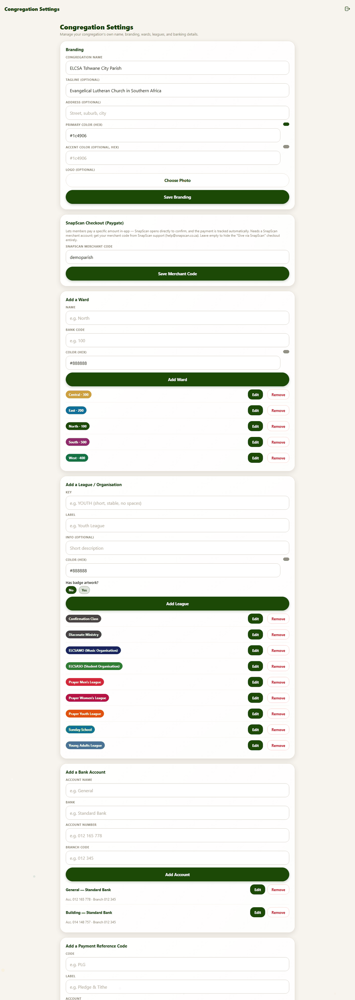
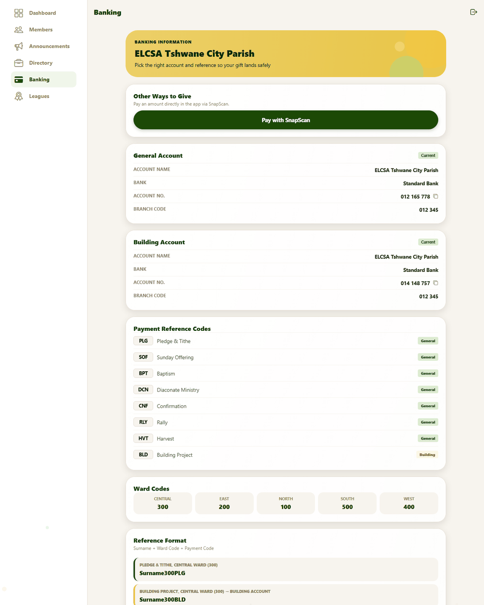

# 9. Congregation settings, banking and giving

**For:** congregation admins. This is where the parish sets up how the app looks, which wards and leagues exist, and where money should be sent.

Open **Members → Congregation Settings** (admins only).

*The full settings page: branding at the top, then SnapScan, then the lists you maintain.*

Each section below has its own **Save** or **Add** button; changes take effect for everyone straight away.

## Branding

| Field | What it does |
|---|---|
| **Congregation Name** | Shown on the front page, sign-in, certificates and in the congregation picker. |
| **Tagline** | The line under the name, e.g. "Evangelical Lutheran Church in Southern Africa". |
| **Address** | Printed on league certificates. |
| **Primary Color** / **Accent Color** | Hex colours, for example `#1c4906`. A small swatch previews the colour. |
| **Logo** | **Choose Photo** — a picture used in place of the standard crest. Optional. |

Press **Save Branding**.

> The front-page banner colour follows the *church year* (green, purple, gold, red) and isn't set here.

## SnapScan checkout

SnapScan lets members pay the parish from the app. It needs a **SnapScan merchant account** (via snapscan.co.za). Once you have its **merchant code**, enter it and press **Save Merchant Code**. Until you do, the *Pay with SnapScan* button is switched off and members use the bank details instead.

Payments are recorded automatically once SnapScan confirms them, which needs a one-off technical step by whoever hosts the app — see [DEPLOYMENT.md → SnapScan giving](../DEPLOYMENT.md#4-snapscan-giving-optional).

## Wards

A ward is a group within the congregation. For each you set a **Name**, a **Color** (hex) and a **Bank Code** (the number used in payment references, such as 300 for Central). **Add Ward** creates one; **Edit** and **Remove** beside each ward change or delete it.

Think before removing a ward that has members.

## Leagues and organisations

For each league: a **Key** (a short stable name; the artwork for the standard leagues is matched on it, so don't change it for those), a **Label** (the name people see), an optional **Info** description, a **Color**, and **Has badge artwork?**. **Add League**, **Edit** and **Remove** work as above.
A league's chairperson, pastor and verse for certificates are *not* here — they are on the league's own page ([guide 8](08-admin-announcements-and-leagues.md#certificate-details)).

## Bank accounts and payment reference codes

What members see on the **Banking** tab is set here:

- **Bank accounts** — an **Account Name**, **Bank**, **Account Number** and **Branch Code**. Members can copy the number with one tap.
- **Payment reference codes** — a short **Code** (for example `PLG`), a **Label** (*Pledge & Tithe*) and the **Account** it belongs to. Members put the code in their deposit's reference so the office can tell what the money is for.

Use **Add**, **Edit** and **Remove** on each list. Check what a code or account is used for before removing it.

## When things change

- A new year, new treasurer, new account? Edit the account here and members see it immediately.
- Leagues come and go: add or remove them here. Check who belongs to a league before removing it.
- Anything about *people* — who belongs where, who is an admin — is in the registry ([guide 6](06-admin-dashboard-and-registry.md)).
