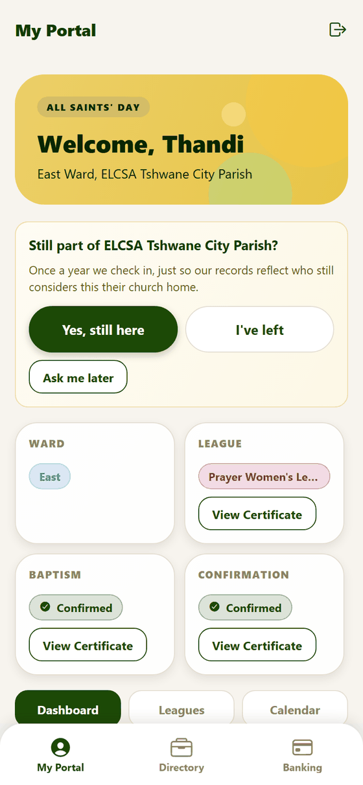
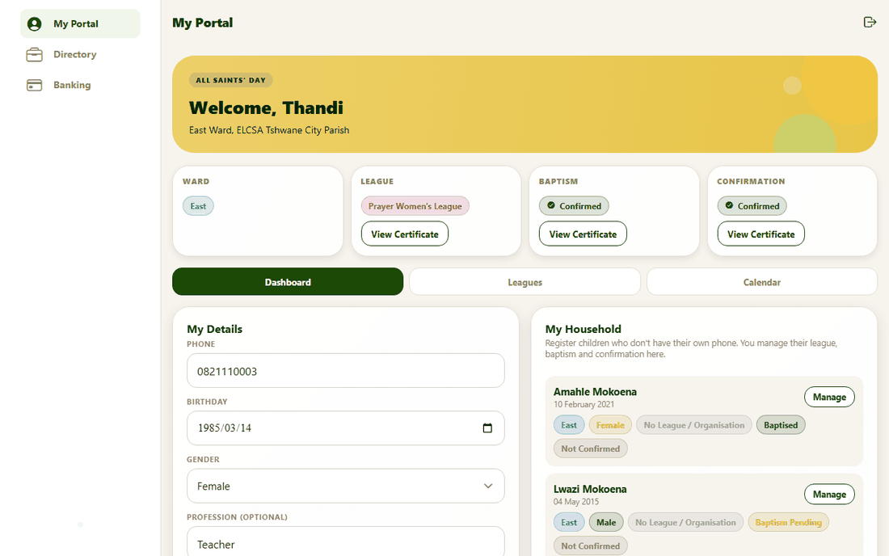
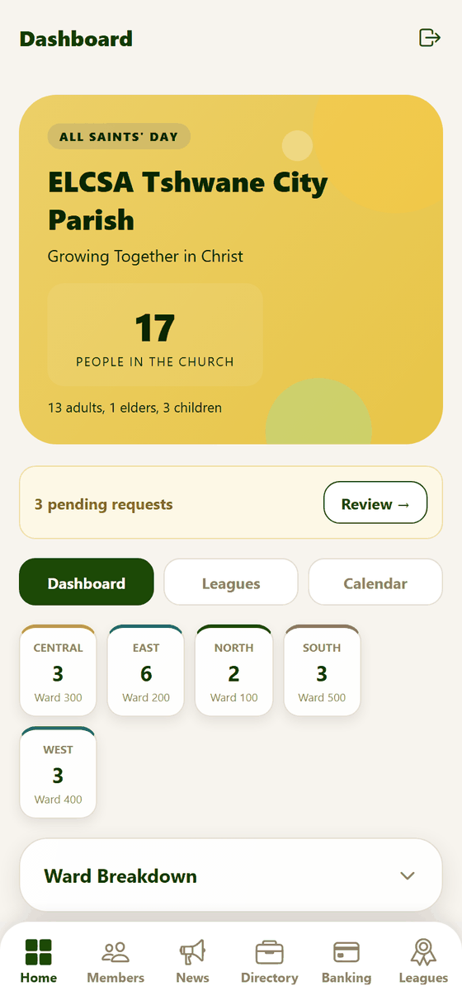
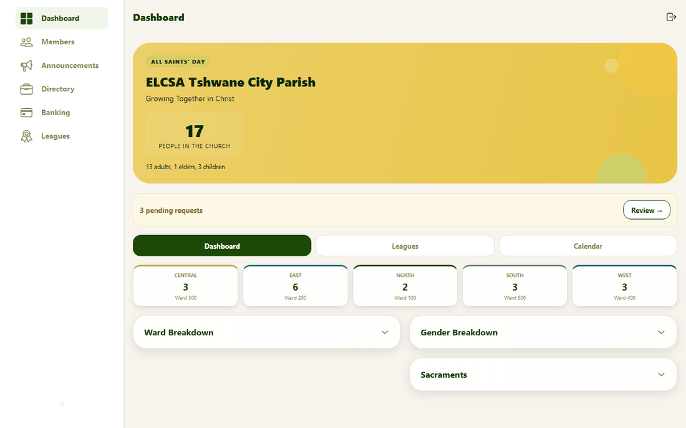
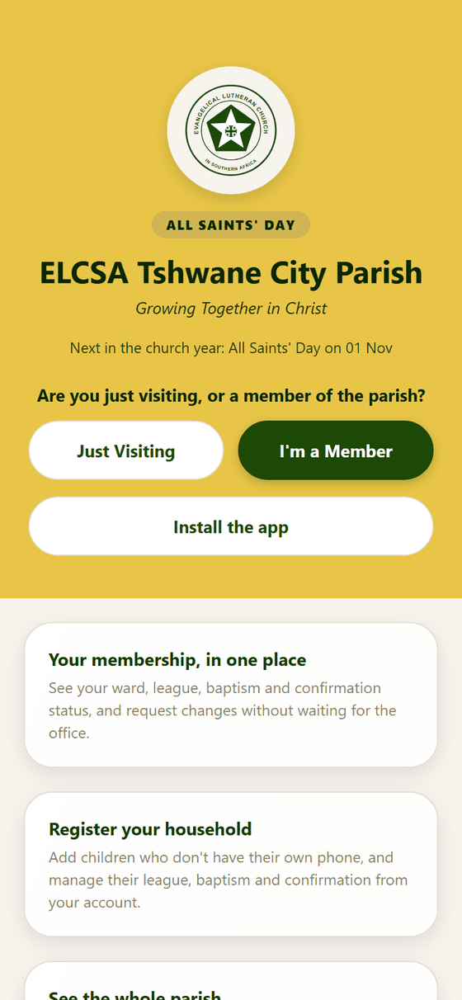
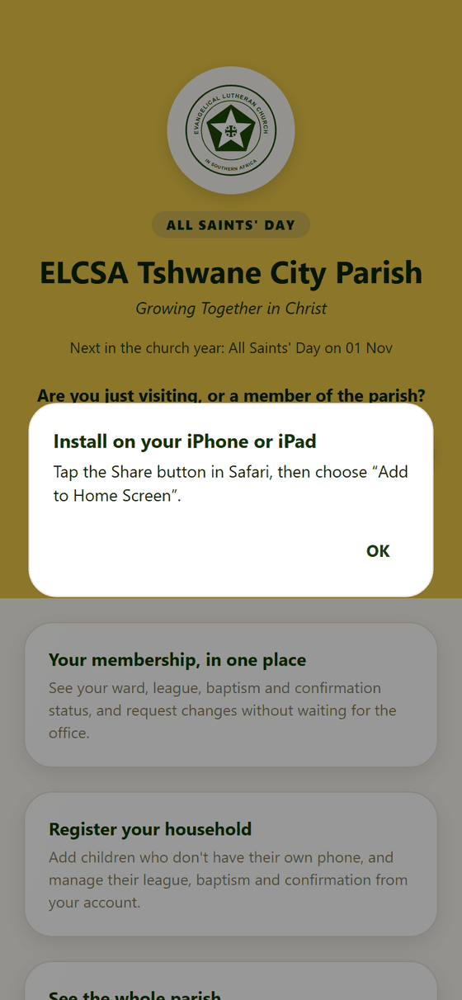

# 10. Phone, computer and installing the app

**For:** everyone. The app is a website that **installs like an app** (a "progressive web app"). It adapts to the screen it is on.

## One app, two layouts

The app looks at the width of the window:

| Window | Layout |
|---|---|
| **Narrower than 900 px** — phones and small tablets | A **bar of tabs along the bottom**, one column of cards |
| **900 px or wider** — computers and large tablets | A slim **sidebar on the left**, content centred, cards in **two columns**, status cards four across |

The *same* member portal:

| Phone | Computer |
|---|---|
|  |  |

And the office's dashboard:

| Phone | Computer |
|---|---|
|  |  |

Resizing a browser window switches layout the moment it crosses 900 px. On a phone's bottom bar the longest tab names are shortened — **Dashboard** becomes **Home** and **Announcements** becomes **News**.

Some effects (the soft blur behind cards, the drifting dots on the background) are used only on computers: they make scrolling shake on phones.

## Installing the app

You don't need an app store. Open the parish website and install it from there; it then has its own icon and opens full screen without the browser's address bar.

### Android (Chrome) and computers (Chrome, Edge)

Press **Install the app** on the front page or sign-in screen. Your browser asks you to confirm. Or use the browser's own install option (the menu → **Install app**, or an install icon in the address bar on a computer).

### iPhone and iPad (Safari)

On an iPhone the browser won't let a page install itself, so **Install the app** shows the steps instead:

*"Tap the Share button in Safari, then choose 'Add to Home Screen'."*

Things to know on an iPhone:

- It must be **Safari**; other iPhone browsers can't add to the home screen.
- An installed app keeps **its own storage**, so you **sign in again** the first time you open it.

### When you don't see the button

**Install the app** only appears when installing is possible and hasn't happened yet. It is hidden:
- inside the installed app itself;
- in browsers that can't install (for example, desktop Firefox);
- if the site isn't on a secure (https) address.

## Working without a connection

The installed app **opens even when you are offline**, and shows its screens. Anything that needs the parish's records — your details, announcements, certificates — needs a connection to load, so those parts show a message instead of data until you are back online.
Changes you make can't be saved until you are back online.

## Getting updates

The app updates itself: each time you open it with a connection it fetches the newest version.
If something looks out of date, **close the app completely and open it again** (sometimes twice). Your sign-in is kept.

## Keeping the screen steady

The app is built so it stays put as you use it:
- text boxes use a size iPhones don't zoom into;
- double-tapping a button doesn't zoom the page (pinching still does, for reading small print);
- the page doesn't bounce when you reach the end, and doesn't jump when the browser's toolbar slides away.

If you see the screen zoom, jump or flicker, please tell the office which phone and browser you use and what you tapped.

## For people who use a screen reader

Every tappable control is a real **button** with a spoken name. Where several buttons look alike — the "Remove" buttons in a list, for example — the spoken name says what they act on, and tab buttons announce which one is selected.
